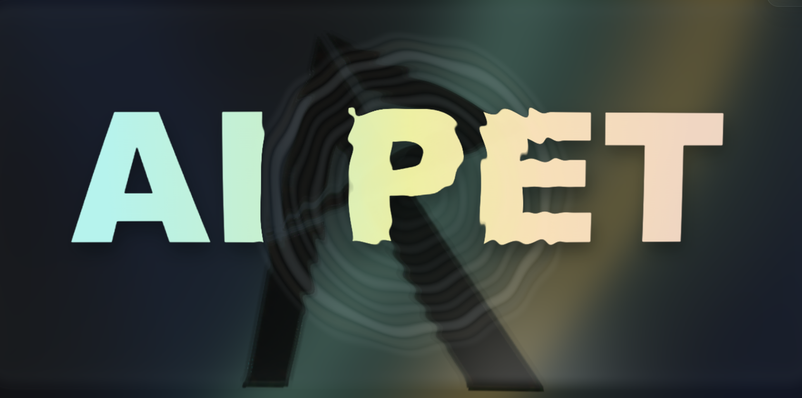
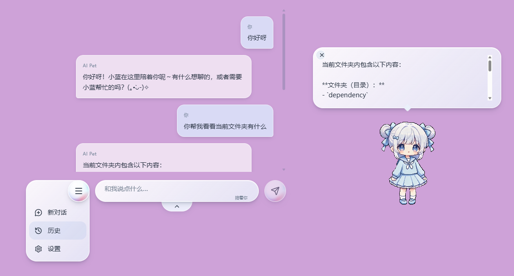
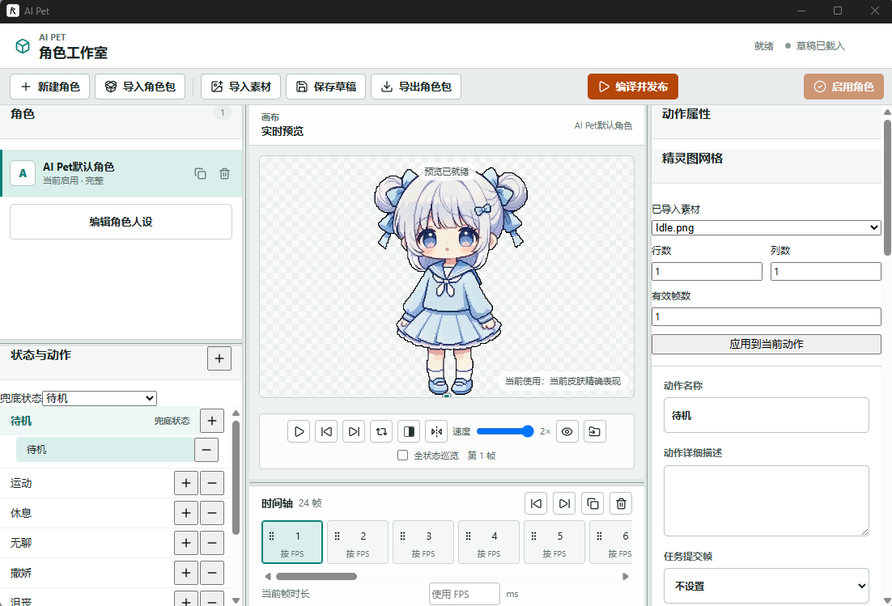

# AI Pet

面向 Windows 10/11 的 2D AI 桌宠：把陪伴聊天、可替换角色与受控的本地 Agent 能力放在同一个桌面伙伴中。

`当前版本：0.1.0-alpha.1` · `目标平台：Windows 10/11 x64` · [访问官网](https://cjmwebsite.cn)



## 项目简介

AI Pet 是一款常驻 Windows 桌面的 2D AI 桌宠。它既提供自然的陪伴交互，也能在用户明确授权后执行受控的本地编程任务。

模型只能提出文本回复或结构化请求；实际的路径校验、权限判断、冲突处理和工具执行都由 Electron Main 在本地可信边界内完成。角色表现、模型配置、文件能力和官网内容链彼此隔离，可以独立演进。

项目当前处于 Alpha 测试阶段。仓库采用 `pnpm` workspace，包含 Electron 桌面端、Next.js 官网、CloudBase API、共享资源包扫描器及多个 TypeScript 共享包。

## 核心能力

### 桌面陪伴

- 透明桌宠窗口、桌面移动、拖拽、托盘和窗口层级控制。
- 普通聊天、流式回复、对话气泡与角色动画反馈。
- 自定义角色状态、动作、心情、长期选择和自主表现。
- 当前会话正文在本机加密保存；无痕内容不补存，重启不恢复旧任务或旧许可。

### 模型与对话

- 支持内置本地 Qwen，以及 OpenAI、Anthropic、Gemini、DeepSeek、通义千问等模型配置。
- Provider Adapter 隔离不同模型协议，API Key 由 Electron `safeStorage` 在本机加密保存。
- 普通聊天不加载本地文件工具；证据不足时不会把文件话题自动升级为文件任务。
- 当前正式编程任务入口限定为 DeepSeek 或内置 Qwen，并在进入任务前确认准确范围。

### 受控编程任务

- 在获批目录内读取、搜索、编辑文件，并运行经过确认的命令、构建或测试。
- 外部目录、删除、覆盖冲突和未批准命令需要具体许可。
- 路径在 Main 中按真实目录、授权根、链接逃逸和受保护区域规则重新校验。
- 任务取消、配置变化、会话变化或授权范围变化会使旧许可失效。
- 删除默认进入 Windows 回收站；不提供模型可直接调用的任意 Shell 权限。



### 角色工作室

- 导入角色素材并编辑状态、动作、方向、播放设置和角色人设。
- 提供实时预览、角色包编译与本地发布。
- 角色包只包含受约束的图片和 JSON 数据，不允许携带任意脚本、命令或系统权限。
- 本地发布与官网投稿是两条独立链路，不会自动上传角色资源。



### 官网与共享资源

- 官网提供产品介绍、Windows 测试版下载、反馈入口和共享资源浏览。
- 角色包投稿进入 CloudBase 私有存储与审核流程，不会因上传成功直接公开。
- 技术扫描、管理员审核与管理员强制发布保留各自的真实结论和审计记录。
- 桌面端业务链与官网内容链严格隔离，网站不能扩大本地 Agent 权限。

## 安全与隐私边界

AI Pet 的本地能力遵循“模型建议，本地裁决”的原则：

1. Renderer 只负责界面、确认、状态和动画，不持有文件系统、进程或密钥能力。
2. Preload 只暴露最小化、强类型、白名单 IPC。
3. Electron Main 负责 Schema 校验、意图识别、任务范围、路径边界、具体许可和工具执行。
4. Provider 返回值不能直接声明本地操作成功，工具结果才是本地操作成败的事实来源。
5. API Key、Authorization、私有令牌和工具原始元数据不会进入普通日志或 Renderer。
6. MCP 源码与持久化数据可以保留，但当前运行时、Agent 和 Renderer 继续保持禁用。

更完整的安全模型见[产品全局设计](docs/superpowers/specs/2026-07-20-ai-desktop-pet-master-design.md)与[编程任务规格](docs/superpowers/specs/2026-09-05-ai-pet-coding-assistant-design.md)。

## 当前状态

当前仓库已经包含桌面陪伴、模型聊天、受控编程任务、角色工作室、会话持久化、官网、投稿审核和 Windows 安装包链路。该描述只代表代码与既有验收记录覆盖的范围，不等同于所有真实 Windows 环境均已完成人工验收。

目前需要注意：

- 安装包是面向少量测试者的未签名 Alpha 版本，Windows 可能显示未知发布者提示。
- 干净环境安装、卸载、跨版本升级及部分真实窗口体验仍需人工确认。
- 当前目标平台仅为 Windows 10/11 x64；macOS 版本尚未发布。
- Windows 桌面自动化仍处于独立安全设计门内，不能借 MCP、Shell 或角色包绕过。
- 官网或 CloudBase 代码存在不代表所有生产配置都已部署，线上状态以最新部署与验收记录为准。

测试版本可从 [AI Pet 官网](https://cjmwebsite.cn)下载。请先核对官网展示的版本、文件名和 SHA-256，并优先使用专用测试目录体验本地文件能力。

## 技术架构

```text
用户
  │
  ▼
Electron Renderer
  │  白名单 IPC
  ▼
Electron Main（本地可信边界）
  ├─ 普通聊天与 Provider 路由
  ├─ 编程任务 Core 与任务范围
  ├─ 权限、路径和文件工具
  ├─ 角色行为与动画调度
  └─ 本地加密设置与当前会话
       │                 │
       ▼                 ▼
  兼容模型 API       用户授权目录

独立官网内容链
Next.js 官网 → CloudBase API → 私有存储／包扫描器 → 人工审核 → 公开资源
```

## 项目结构

| 路径 | 职责 |
| --- | --- |
| `apps/desktop` | Electron Main、Preload、Renderer、桌宠窗口与角色工作室 |
| `apps/website` | Next.js 官网、下载、反馈与共享资源界面 |
| `apps/cloudbase-api` | 投稿、审核、公开读取和管理端 API |
| `apps/package-scanner` | 共享角色包的隔离扫描与技术结论 |
| `packages/shared-types` | 跨进程和跨应用公共契约 |
| `packages/agent-core` | 普通聊天、Provider、路由和表现建议协议 |
| `packages/coding-task-core` | 正式文件／命令任务的原会话、工具与权限服务 |
| `packages/file-tools` | 路径、受保护区域和文件安全边界 |
| `packages/character-runtime` | 角色契约、状态仲裁和运行时行为 |
| `packages/character-assets` | 角色素材、角色包编译与校验 |
| `tests` | 跨包安全、集成与 Electron／网站端到端测试 |
| `docs` | 产品规格、实施计划、运维说明与验收记录 |

## 快速开始

### 环境要求

- Windows 10/11 x64
- Node.js 与 Corepack
- `pnpm 11.9.0`

在仓库根目录安装依赖：

```powershell
corepack enable
corepack prepare pnpm@11.9.0 --activate
pnpm.cmd install --frozen-lockfile
```

启动桌面端开发环境：

```powershell
pnpm.cmd --filter @myself/desktop dev
```

启动官网开发环境：

```powershell
pnpm.cmd --filter @myself/website dev
```

构建 Windows 安装包前，请先确认本地模型资源和打包环境符合仓库脚本要求：

```powershell
pnpm.cmd --filter @myself/desktop package:win
```

## 验证命令

执行前以根目录及各 workspace 的 `package.json` 为准。Windows 下优先使用 `pnpm.cmd`。

| 范围 | 命令 |
| --- | --- |
| 全工作区类型检查 | `pnpm.cmd typecheck` |
| 桌面端完整门禁 | `pnpm.cmd verify:desktop` |
| 角色行为门禁 | `pnpm.cmd verify:behavior` |
| 角色与工作室门禁 | `pnpm.cmd verify:characters` |
| 安全测试 | `pnpm.cmd test:security` |
| 集成测试 | `pnpm.cmd test:integration` |
| 官网门禁 | `pnpm.cmd verify:website` |
| CloudBase 与扫描器门禁 | `pnpm.cmd verify:cloudbase` |

自动化测试不能替代真实 Windows 窗口层级、鼠标拖拽、系统托盘、资源管理器交互及干净环境安装卸载的人工验收。

## 开发约定

- 修改前阅读根目录 [AGENTS.md](AGENTS.md) 以及目标目录内更深层的协作规则。
- 行为变化先规格化，多步骤任务采用 SDD，功能和缺陷修复采用 RED → GREEN → REFACTOR。
- 优先复用现有接口、状态机、组件和工具，以最少文件和最少代码完成目标。
- 面向人的文档和结构性代码注释使用中文。
- 新路径替代旧功能后，应在验证通过后删除旧实现、旧入口和只服务旧设计的测试。

## 文档导航

- [产品全局设计与演进计划](docs/superpowers/specs/2026-07-20-ai-desktop-pet-master-design.md)
- [自主陪伴路线图](docs/superpowers/plans/2026-08-01-ai-pet-autonomous-companion-roadmap.md)
- [编程任务设计](docs/superpowers/specs/2026-09-05-ai-pet-coding-assistant-design.md)
- [DeepSeek／内置 Qwen 编程任务验收](docs/operations/2026-09-05-deepseek-qwen-coding-tasks.md)
- [角色工作室验收](docs/operations/character-workshop-acceptance.md)
- [当前会话持久化验收](docs/operations/2026-09-13-current-conversation-persistence-acceptance.md)
- [CloudBase 部署说明](docs/operations/cloudbase-deployment.md)
- [内容审核说明](docs/operations/content-moderation.md)

## 项目边界

AI Pet 不把整台电脑权限交给模型，也不把角色包当作脚本或插件容器。普通聊天、角色表现、本地编程任务和官网内容各自遵守独立边界；任何新的系统能力都需要先完成安全设计、权限契约和验收。

当前阶段的目标是让桌宠陪伴与本地任务形成可靠、可解释、可取消的闭环，而不是追求无人值守的全能自动化。
