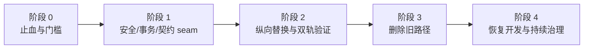

# 2026-08-13 架构优化路线图

## 1. 总则与恢复开发条件

本路线只定义后续独立 SDD/TDD 的顺序，不在本轮实现。每个任务都按一条可观察的业务流纵向切割；禁止按 Controller/Service/Repository 等横向层批量迁移，禁止一次替换整个系统。新 seam 只有在生产 adapter 与测试 adapter（或两个真实 implementation）都成立时才引入。

常规功能开发恢复前必须满足：

1. `W-S0-1` 与 `D-S0-1` 均关闭并通过动态安全验收。
2. `G-S1-1` 的旧 migration runner 已停止使用；新 runner 至少完成 dry-run、账本/事务/锁故障注入和一个非生产环境 smoke。
3. 其余 S1 已完成目标 seam 与失败门，或由用户显式接受残余风险、指定 owner/期限并在 `verify:repo` 中建立防回归门。
4. 新代码不得增加 website↔desktop implementation 依赖、packages→apps 反向依赖、第二个持久化 writer、第二份 wire/schema owner 或无退役条件的兼容路径。
5. 每个纵向替换在新 interface 双轨通过后，必须在同一规格的收尾任务删除旧 owner、旧入口、复制契约和只维护旧实现的测试；未完成删除不得把任务标记为结束。

依赖主链：

## 2. 阶段 0：止血规则与恢复开发门槛

### 目标、范围与前置条件

目标是在不改业务功能的前提下阻止已知高风险路径继续扩大，并为后续规格建立可执行完成定义。范围是安全开关、部署禁令、依赖/owner 规则和最小红测；前置条件是本审查文档获确认、当前分支保持可回滚、真实部署状态由用户或环境 owner补充。

明确非目标：本阶段不恢复 scanner、不迁移数据库、不重写 IPC/设置/角色仓储，不删除兼容代码，也不宣称仓库测试等于真实云端或 Windows 验收。

### 按 ID 排序的任务与依赖

1. **`W-S0-1` 共享包发布止血**：在正式批准路径和操作手册同时规定“无与当前对象身份绑定的 scan pass，不得批准 shared_package”。若 scanner 尚不可用，关闭共享包匿名写入/批准，保留公开只读、反馈与建议人工审核。它不依赖 scanner 恢复，是所有社区新功能的前置。
2. **`D-S0-1` Agent 窗口授权红门**：新增非法 pet/settings/workshop/旧 chat sender 的失败测试和当前 chat 成功测试；在实现前先把该组安全测试列为桌面恢复开发门。
3. **`G-S1-1` migration 部署冻结**：停止把 `node tools/apply-cloudbase-migrations.mjs` 用于任何环境；只允许只读 inventory/dry-run 设计，直至数据库事务与锁语义被证明。
4. **`G-S1-2` 仓库完成定义草案**：列出 10/10 workspace、两份工具测试、build/E2E/容器/人工门的 owner；在 `verify:repo` 完成前，交付记录必须逐项列实际运行命令，不能写“全仓已通过”。
5. 建立全仓止血规则：禁止新 `shared-types` 根语义、跨应用内部路径、第二份 release/scanner schema、直接写他人目录、无 deadline 的远程调用和无退出条件的 compatibility adapter。

### 最小纵向切片与 TDD

- `W-S0-1` 第一切片只覆盖“管理员批准一个无 scan pass 的新 shared_package”：红测应在服务与 SQL 同时失败；绿测只加门，不先恢复 worker。
- `D-S0-1` 第一切片只覆盖 `actionConfirm` 的 sender；通过后再以相同 seam 扩展 submit/cancel/disclosure/reset，避免同时调整事件投影。
- `G-S1-1` 第一切片只解析 migration inventory/checksum，不连接数据库；以缺号、重复、checksum 漂移先红。
- `G-S1-2` 第一切片只枚举 workspace→test owner，先让当前四个遗漏 workspace 红，不先重排所有命令。

### 动态/故障注入/构建验收

- 在隔离环境确认无 scan pass 的共享包 UI、服务、SQL 三层均拒绝；公开只读和反馈不受影响。
- Electron registrar 测试观察真实 `event.sender`，确认非法 sender 时 service 零调用。
- migration 命令只能输出 plan，不产生数据库写；旧入口调用在操作流程中被明确拒绝。
- workspace 覆盖检查对新增临时 workspace 稳定失败。

### 风险、回滚点与退出标准

风险是止血造成共享包暂时不可投稿/批准、设置或 Agent 流程短期更严格。安全门以功能关闭为回滚点，而不是恢复无扫描批准或无 sender 校验。阶段退出标准：两项 S0 有可重复红测和临时门；旧 migration runner 被标记禁止；workspace 门清单可机器检查；常规功能开发仍保持冻结。

## 3. 阶段 1：建立安全、事务与契约 seam

### 目标、范围与前置条件

目标是先建立能承载纵向替换的深 module interface，关闭 S0 并处理全部 S1 的根 seam。范围包含 Agent sender/事件投影、共享包发布门、角色 journal、CloudBase migration/config、scanner 协议和仓库验证。前置是阶段 0 全部退出条件满足。

明确非目标：不拆分 Main/CharacterStore/CloudBasePostgresStore 大文件，不搬迁 Agent/Coordinator 状态机，不把 Package 外层 saga移入 Asset，不删除 V1/MCP/scanner 历史兼容。

### 按 ID 排序的任务与依赖

1. **`W-S0-1` `SharedPackagePublicationGate`**：先实现服务/SQL 原子双门；随后恢复 `uploading → system_reviewing → manual_review_pending` 和 current-object scan evidence。依赖 `W-S1-2` 的协议测试与 `G-S2-2` 的镜像候选门后，才允许真实 scanner 恢复。
2. **`D-S0-1` `AgentIpcAuthorization` + `ConversationEventProjection`**：动态读取当前 chat sender；guard 与事件投影分两次提交。`D-S2-1` 展示 snapshot 可后续补充，不阻塞先关闭越权。
3. **`D-S1-1` `CharacterTransactionRecovery`**：按角色、按 draft/publish 分面返回结果；不改 marker 格式。依赖现有 Store fault injection，无外部依赖。
4. **`D-S1-2` `CharacterImportJournal`**：设计 Windows exclusive-create 原子发布、坏 marker 保留与 owner 身份回滚。不得假设普通 rename 自带 no-overwrite。
5. **`W-S1-1` 三个配置 loader**：cleanup→API→moderation 逐个切换；共享读取器只负责共同字段。
6. **`W-S1-2` `ScannerProtocol`**：先真实 client↔server 测试，再下沉 schema/version/canonical signing；协议双轨必须带明确删除版本。
7. **`G-S1-1` `CloudBaseMigrationRunner`**：专用数据库会话、整轮 advisory lock、锁内 ledger 重读；每份 SQL body 与 ledger/checksum 同事务。无法证明 adapter 语义即停止。
8. **`G-S1-2` `RepositoryVerification`**：建立 `test:core`、`test:all`、`verify:repo`；package 自有 adapter 不被根配置吞并。

### 最小纵向切片与 TDD 红绿重构

每项遵循：先写当前失败的一个场景 → 证明失败原因准确 → 加最小 interface/adapter → 只让该场景变绿 → 跑该域回归 → 重构内部命名/重复 → 进入下一场景。

- `D-S1-1` 依次做 bad draft + valid compiled、bad publish non-active、bad publish active、两者并存；每步只增加一个状态转换。
- `D-S1-2` 依次做空 marker、半 JSON、未知 schema、各写入 kill-point、owner mismatch；不先抽象整个 PackageService。
- `W-S1-1` 每个函数只迁移自己的真实环境矩阵，三个入口可独立评审/回滚。
- `W-S1-2` contract cases先覆盖成功、篡改、过期、重放，再扩错误和大小；扫描业务实现保持原位。
- `G-S1-1` 先 inventory/plan，再 fake adapter 的事务/锁，最后非生产 PostgreSQL smoke；SQL 历史文件不就地改写。
- `G-S1-2` 先 package test owner，再 build contract，最后将 E2E/镜像/人工项作为分层门，而不是塞进快速 test。

### 动态/故障注入/构建验收

- Agent：真实 registrar/sender、chat 销毁重建、文件/PowerShell E2E、pet motion 回归。
- 角色：open/write/rename/publish/owner 各 checkpoint 终止，重启后无关角色可用且证据字节保留。
- 扫描：临时 server、独立 build 产物、HMAC 篡改/重放/超大/畸形响应。
- Migration：SQL 中途、DDL 后 ledger 前、ledger 写、commit 前/后失联、双 runner；失败后重跑不跳过/重放。
- Repository gate：10/10 workspace 有 owner，同 project 不重复，desktop/website E2E 不并行。

### 风险、回滚点与退出标准

主要风险是安全门过严、角色恢复误封 healthy runtime、配置漏项、scanner 双版本长期化、migration ledger 基线错误。回滚单位必须是单个 adapter/纵向提交；数据库一旦 commit 只允许新的前向修复 migration，不回滚历史 SQL。阶段退出标准：S0 全部关闭；六项 S1 的 interface、红绿矩阵和失败门完成；未完成 scanner 动态验收时共享包继续关闭；`verify:repo` 能说明未执行的外部门。

## 4. 阶段 2：纵向替换与双轨验证

### 目标、范围与前置条件

目标是在阶段 1 seam 后逐条迁移 S2，不增加平行 owner。范围是会话、Provider、角色存储、网站契约/数据流、发布与工程候选门。前置是相关 S0/S1 已关闭或 seam 已可用；任务可按依赖并行，但每个任务只改一条业务流。

明确非目标：不统一所有 repository、不建设万能 contract 包、不一次迁移所有分页或设置入口、不把真实部署外部事实伪造成单元测试。

### 任务组 A：桌宠纵向切片

1. **`D-S2-1` 展示快照**：先 running reload，再 disclosure、file confirm、PowerShell confirm，最后显式销毁重建；render-process crash 生命周期另立规格。
2. **`D-S2-2` 会话窄契约**：code-point helper 和 preload `taskEventSchema` 解析是两个小提交；无参数 channel 偏好不作为门。
3. **`D-S2-3` fallback 诚实化**：先 UI/保存契约只声明真实四格矩阵；再扩现有 `ModelSelection` 接普通 chat same-provider；跨 Provider disclosure 是独立高风险规格，工具副作用后禁止 replay。
4. **`D-S2-4` 设置 mutation 权威**：legacy 委托 advanced transaction，配置 lifecycle 返回 Promise并 await；失败显式返回，Coordinator 进入可重试安全态。消费者验证后才删旧 route。
5. **`D-S2-5` compiled authority handoff**：handoff 先于 Store/Asset 任一入口；有效 V2 永远优先；按角色、幂等、失败留证。矩阵全绿后进入阶段 3 删除旧 writer/recovery。
6. **`D-S2-6` source 安装 port**：只迁移 PackageService 的 source copy/catalog 切片，外层 marker/owner/publish/rollback 不动；固定 lock order。

### 任务组 B：网站与云端纵向切片

1. **`W-S2-1` 浏览器响应边界**：共享包补 Zod，公开 DTO 加本地 schema，共享包/反馈按 receipt 状态渲染。
2. **`W-S2-2` 正式 repository 收窄**：先迁移仍有价值的页面行为到 current in-memory adapter，再去掉 optional/test-only 字段；旧实现删除放阶段 3。
3. **`W-S2-3` keyset cursor**：先一个公开列表，双协议观察稳定后迁移反馈与管理员队列，最终删除 numeric offset adapter。
4. **`W-S2-4` 幂等互动**：desired like + operationId 先行；下载只在签名和幂等计数均成功时返回 URL，不引入安装遥测。
5. **`W-S2-5` release contract**：真实 generator→唯一 schema→website consumer；增加不上传的 exe/manifest/website candidate verifier。
6. **`W-S2-6` published catalog 不变量**：先只读审计存量，单独清理后增加 cover/package 部分唯一索引和发布检查；derived 保持多值；再做逐项读取隔离。
7. **`W-S2-7` bounded JSON**：先锁定 ScannerClient 错误行为，提取底层 helper，再迁 RPC deadline/size；三函数各自注入小于平台截止的值。
8. **`W-S2-8` 默认角色投影 adapter**：以桌面 metadata 枚举并验证网站 metadata和真实字节；先集中路径，自动复制若确有需求另立小规格。

### 任务组 C：工程验证纵向切片

1. **`G-S2-1` Website API contract suite**：同一 cases 同跑 production in-process 与 memory adapter，再让 E2E 只保留确定性存储/控制面。
2. **`G-S2-2` scanner candidate**：先 Vite build，再本地镜像 health/EICAR/timeout，记录 digest/ClamAV DB；真实 IMS仍是部署门。
3. **`G-S2-3` 文档生命周期**：建立类别、owner、last-verified、superseded-by 与验收记录字段；只修当前入口和危险冲突。
4. **`G-S2-4` 上下文地图**：本 `system-map.md` 作为唯一 owner；后续只给根 `CONTEXT.md` 标桌宠适用域并回链，不创建平行地图。

### 依赖关系与最小切片顺序

`D-S2-1` 在 `D-S0-1` 后实施，`D-S2-5` 必须先于删除 Asset recovery；`W-S2-1/G-S2-1` 共享当前 HTTP contract cases但各保留自身 adapter责任；`W-S2-5` 提供 release candidate contract给后续工程门；`G-S2-2` 与 `W-S1-2` 共同作为恢复 `W-S0-1` scanner 路径的前置。其余任务按“一个角色、一个列表、一个函数、一个 adapter或一个发布产物”作为最小纵向切片，不因同属 S2 合并成批量迁移。

### TDD、动态验收、风险与回滚

每个切片保留旧 adapter 作为短期双轨，但要记录删除条件和最长兼容阶段。测试通过同一新 interface 比较新旧可观察结果，不穿透 implementation。动态矩阵包括 chat hydrate、Provider 目标披露、角色 handoff/restart、分页集合变化、HTTP响应丢失重放、SQL存量/约束、RPC 卡住/超大、generator/consumer、两种网站 API adapter、scanner image。

风险集中在快照泄露私有状态、failover 重放副作用、legacy marker 覆盖 V2、SQL索引阻塞存量、双 cursor/协议长期化、文档规则制造批量噪声。每项以 runtime flag、版本 adapter、单列表/单角色/单函数提交或前向 SQL 为回滚点；不得删除数据证据。阶段退出标准：目标 S2 的新 interface 至少有生产与测试 adapter；双轨差异为零或已显式裁决；阶段 3 删除清单和消费者搜索完成。

## 5. 阶段 3：删除旧路径和收窄兼容面

### 目标、范围与前置条件

目标是兑现“替换而非叠层”，只删除已由阶段 2 新路径覆盖且满足证据门的旧 owner/入口。前置是对应纵向切片的功能、安全、故障注入、构建/E2E 全绿，consumer 搜索和外部兼容义务已经裁决。

明确非目标：不按 `legacy`/`V1` 名称批量删除，不移除真实数据迁移、V2→legacy 只读投影、MCP 保留、历史审核状态或有效静态检查；大量文件删除若出现，必须再次取得用户批准。

### 删除任务

1. **`D-S2-4`**：删除 `settingsGet/settingsSaveProvider/settingsTestProvider` 的 channel、preload、`MyselfApi` 与旧测试；保留 choose-root/clear-data 等仍用接口。
2. **`D-S2-5`**：handoff 矩阵和兼容周期通过后，删除 Asset `saveCompiled`、compiled catalog/transaction recovery 及只维护旧 writer 的测试；source transaction 保留。
3. **`D-S2-6`**：删除 Package 中直接 source 路径/catalog 写入和 concrete test inheritance；外层 saga不删。
4. **`W-S2-2`**：删除 IndexedDB/LocalStorage 共享内容 implementation、test-only optional interface 和仅验证旧内部存储的测试；语言偏好存储不删。
5. **`W-S2-3`、`W-S2-4`、`W-S2-5`、`W-S1-2`**：分别删除 numeric cursor、toggle/先计数、两份 release schema、旧 scanner 协议版本；每项只在遥测/日志证明旧消费者为零后执行。
6. **`W-S3-1`**：build/引用/CSS 审计后独立删除不可达旧首页组件和专属资源。
7. **`D-S3-1`、`D-S3-2`**：删除 atlas 伪 V1 contract、复制 fixture 类型、对应 casts和已被 executable seam 替代的字符串断言；保留构建/静态契约检查。
8. **`G-S3-1`**：profile 等价则删除重复 build；不同则删除覆盖同目录的旧编排，保留两个隔离且命名清晰的 profile。

依赖关系严格是一对一的“阶段 2 新路径已验收 → 阶段 3 删除对应旧路径”；不得以另一个相似切片已通过替代本切片证据。每次最小删除只处理一个 owner、一个入口族或一组只维护该旧实现的测试。

### TDD/构建验收

每个删除任务先用 `rg` 建消费者清单和负向断言；删除后运行该 package unit/typecheck、相关 security/integration、对应 E2E/build，再跑 `verify:repo`。涉及磁盘、协议或发布的删除还要动态重启旧数据、回放旧版本请求或构建真实候选，证明兼容 adapter 已完成交接。V1 fixture、MCP数据、published/derived、静态 builder/Docker/preload 检查需列入保护回归。旧磁盘 marker 只有成功 handoff 后才删除；历史文档不删除。

### 风险、回滚点与退出标准

风险是隐藏外部自动化、旧磁盘数据、双版本客户端或仅静态表达的发布入口。回滚点是删除前最后一个独立提交和仍可读取旧格式的新 adapter；不得回滚数据库为旧 schema。退出标准：旧 owner/入口搜索为零，包体/测试相应收缩，新旧不是永久并存，兼容保留项有 owner、触发条件和未来退役门。

## 6. 阶段 4：恢复功能开发与持续架构治理

### 目标、范围与前置条件

目标是在 S0 关闭、S1 有明确处置、旧路径已收窄后恢复常规功能，并用轻量门防止再次堆叠。范围是验证门、架构地图、发布证据和周期诊断；前置是阶段 3 针对已迁移切片完成。

明确非目标：Graphify 不进入每次 build/test，不要求每个提交重建全图，不用图的中心性设文件大小门，也不以自动化替代真实云端、Windows和人工安全验收。

### 持续任务

1. `verify:repo` 负责 workspace 覆盖、typecheck、全测试与可生成 build contract；domain gate 保留快速反馈；E2E/image/人工门分层展示。
2. `system-map.md` 在 workspace/interface/依赖/发布 owner变化时更新；`G-S2-3` 文档规则验证当前入口、链接、命令和验收证据。
3. 每个 release candidate 记录 commit、exe/manifest checksum、网站 consumer结果、scanner image digest或 CloudBase migration ledger；没有证据不写“已完成”。
4. Graphify 作为按需诊断工具：架构审查、跨域变更或异常依赖调查时，从仓库外 `D:\Python\Graphify` 重建；原始产物继续外置，所有图边仍按“有限通过”回源。
5. 每季度或跨域规格前检查：packages→apps、website↔desktop implementation、共享根 barrel、新 writer、无 deadline 远程调用、兼容 adapter年龄和旧入口搜索。

依赖关系是：`verify:repo` 依赖 `G-S1-2`，scanner/release/migration 证据分别依赖 `G-S2-2`、`W-S2-5`、`G-S1-1`，文档门依赖 `G-S2-3/G-S2-4`。最小纵向切片是“一个后续功能的用户入口→稳定 seam→adapter→可观察结果→删除被替换旧入口”，不得先建设与具体功能无关的横向框架。

### 动态/构建验收、风险与退出标准

恢复后的首个功能规格必须选一个纵向切片，并在计划中列出本地图节点、审查 ID 影响、interface、adapter、红绿重构和旧路径删除。TDD 必须先以用户可观察结果写红测，只加入使该切片变绿的最小 implementation，再通过同一 interface 重构；不能先扩展横向框架。仓库 gate 全绿只代表仓库内事实；云端 smoke、scanner image、SQL ledger、NSIS干净机和远端字节仍需独立记录。

主要风险是门禁变慢后被绕开、文档变成第二套实现、Graphify被误用为事实库。以快速/完整门分层、文档更新触发器和图谱回源规则控制。单项治理规则若误报，可回滚该规则或恢复上一版编排，但不得回滚已经关闭的安全门、数据库前向 migration 或重新引入旧 owner。阶段退出标准是恢复常规功能开发后，新增 workspace/契约/发布链会自动触发 owner检查，且每个完成的纵向替换都已删除旧 owner。

## 7. 建议的首批后续 SDD/TDD 规格

首批必须建立两份彼此独立的规格，不能合并成跨域大规格。第一执行项建议为：**“共享角色包发布扫描门恢复与失败关闭（`W-S0-1`）”**；紧随其后或由独立工作树并行执行：**“Agent 当前聊天窗口 IPC 授权与确认事件投影（`D-S0-1`）”**。

该规格只包含两个可独立评审的纵向切片：

1. 切片 A：服务与 SQL 同时拒绝 `manual_review_pending + shared_package + 无当前对象 scan pass`，并提供稳定管理员错误；scanner 不可用时保持共享包入口关闭。
2. 切片 B：在 `W-S1-2` 协议契约和 `G-S2-2` 镜像候选门满足后，恢复上传→系统审核→人工审核，并用真实干净包、EICAR、结构边界、超时/重试证明失败关闭。

它不修改反馈/建议人工审核，不重写 AdminService/ModerationService/SQL 状态机，不同时处理分页或网站 UI 架构。完成标准是未扫描/陈旧证据无法在 UI、服务或 SQL 任一层批准，当前有效技术证据才可公开；回滚只能关闭共享包写入/批准，不能恢复无扫描发布。

`D-S0-1` 规格也只含两个小切片：先用动态当前 chat `WebContents` guard 保护 confirm/submit/cancel/disclosure/reset，再把完整 `TaskEvent` 限于 chat、让 pet 继续走已有行为投影。它不与会话 snapshot、Provider 或 `MyselfApi` 全面收窄合并；验收要求非 chat/旧 chat sender service 零调用、当前 chat 可用、非 chat 不收到 actionId/command/contentPreview，现有文件/PowerShell E2E 与 pet motion 不回归。
