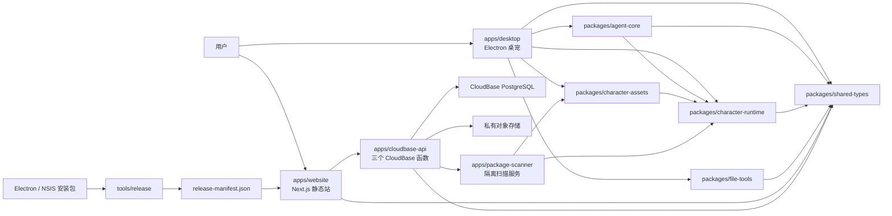
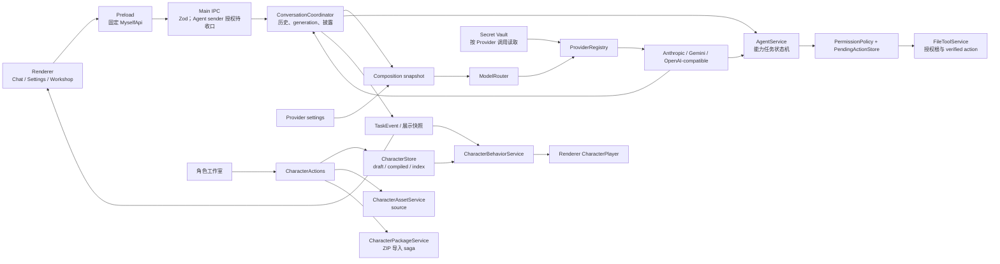
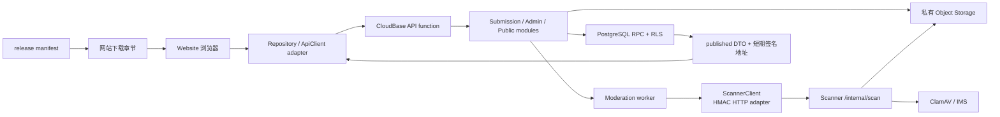
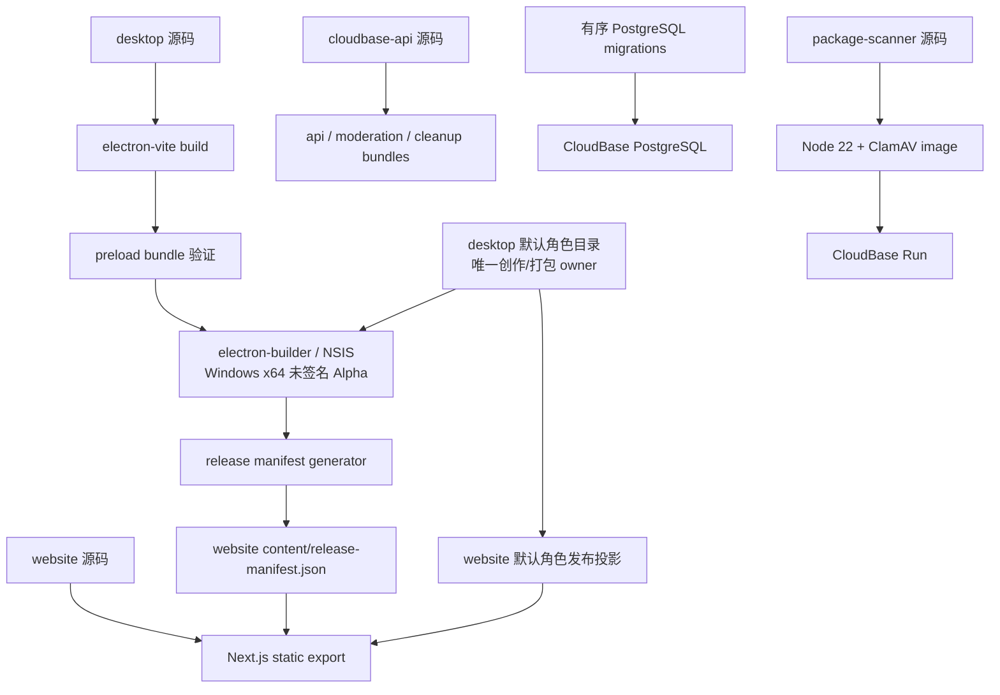

# Myself 全仓系统地图

> 当前基准：`main_Graphify_test` / `a05294be01ecea0a420aa7951508b2af3259a3c5`（2026-08-13）
> 文档职责：本文件是 monorepo 唯一长期上下文地图 owner；历史规格和计划保留决策过程，不与本文件竞争“当前结构”解释权。

## 1. 使用与更新规则

出现以下任一变化时，变更规格必须同步核对本文件：新增或删除 workspace；公开 interface、依赖方向、IPC/HTTP/文件协议变化；数据库状态机变化；构建、部署或发布产物变化；默认角色资源 owner 变化；某条兼容路径退役。只改模块内部 implementation、且 interface、依赖方向和运行时链路均不变时，不必更新地图。

后续 SDD/TDD 先从本文件确定业务上下文、owner 和 seam，再回到源码与当前规格。根 [`CONTEXT.md`](../../CONTEXT.md) 只定义桌宠文件授权和对话词汇；[`docs/superpowers/specs`](../superpowers/specs) 与 [`docs/superpowers/plans`](../superpowers/plans) 是按日期保存的决策和执行记录，不能单凭复选框或旧描述判断当前事实。

## 2. 业务上下文与共享边界

仓库包含两个基本独立的核心业务：

- **Desktop Companion（桌宠 AI Agent）**：Electron 桌面应用，负责对话、Provider 路由、文件能力、用户确认、角色编辑/运行、Explorer/Windows 集成和安装包构建。
- **Website / Cloud Community（网站与云端社区）**：Next.js 静态网站、CloudBase API/PostgreSQL、隔离扫描器及发布工具，负责内容投稿、审核、公开展示、反馈、软件下载与部署。

两者只应通过三类显式边连接：最小共享契约（`@myself/shared-types`）、角色包/资源格式，以及安装包与 release manifest。网站生产代码不得依赖桌面 implementation；桌面生产代码不得依赖网站 implementation；`packages/*` 不得反向依赖 `apps/*`。

容易混淆的术语：

| 术语 | 精确定义 |
|---|---|
| 角色发布 | 将工作室草稿编译为角色 `compiled/` 正式运行版本。 |
| 内容发布 | 管理员批准投稿，使其进入 `published` 并可公开读取。 |
| 软件发布 | 构建 NSIS 安装包、生成 release manifest、上传正式存储并让网站暴露下载。 |
| 角色包 | 可导入/扫描的角色 ZIP。 |
| 安装包 | Windows x64 NSIS `.exe`。 |
| owner | 对某项持久化格式、契约或发布源拥有唯一写入决定权的模块。 |

## 3. Workspace 清单

| Workspace | 业务职责 | 公开 interface / 主要 implementation | 依赖方向与关键 seam |
|---|---|---|---|
| `apps/desktop` | Electron 桌宠、窗口、IPC、Agent 编排、角色和设置 | `MyselfApi`、`ipcChannels`、`MainConversationComposition`、`CharacterActions`；Main/Preload/Renderer implementations | → `agent-core`、`character-*`、`file-tools`、`shared-types`；窗口 sender、IPC DTO、角色 repository、Provider factory 是关键 seam |
| `apps/website` | 静态官网、社区、反馈、管理员与下载 UI | `SharedPetRepository`、`FeedbackRepository`、`ApiClient`、Next 路由与章节 registry | → `shared-types`、CloudBase HTTP；不得 import desktop implementation |
| `apps/cloudbase-api` | 三个 CloudBase 函数、投稿/审核/公开/清理编排 | 细分 store ports、`SubmissionService`、`AdminService`、`PublicContentService`、`PackageScanner` port | → `shared-types`、PostgreSQL/Object Storage、scanner HTTP；SQL 是原子状态事实源 |
| `apps/package-scanner` | 隔离下载、ZIP/恶意文件/图片/结构扫描 | `/internal/scan`、HMAC 协议、`scanPackage` | → `character-assets`、`character-runtime`、ClamAV/IMS；远程但自有 seam |
| `packages/shared-types` | 跨进程/跨应用 Zod 契约和类型 | `contracts.ts`、`moderation.ts`、`provider-catalog.ts` 经根 barrel 暴露 | 不依赖 apps；只容纳真实多消费者语义，新增契约优先子路径或独立小包 |
| `packages/agent-core` | Agent loop、模型选择和抽象类型 | `AgentLoop`、`ModelRouter`、`ModelSelection` | → `character-runtime`、`shared-types`；模型选择→Coordinator 是 failover/disclosure seam |
| `packages/character-runtime` | V1/V2 schema、迁移、行为和播放决策 | schema、converter、projection、behavior engine | → `shared-types`；纯逻辑，不读写应用目录 |
| `packages/character-assets` | 角色包结构、资源限制、atlas/frame 校验 | package policy/structure、frame import、atlas layout | → `character-runtime`；由 desktop 与 scanner 共用 |
| `packages/file-tools` | 授权根、路径策略、安全文件操作和回收站 | `PathPolicy`、`FileToolService`、`RecycleBinPort` | → `shared-types`；Renderer 不接触绝对路径/私有执行对象 |
| `tools/release` | 从最终安装包生成 release manifest | `generate:manifest` | → 文件系统与 release contract；不得成为网站运行时依赖 |

## 4. 全仓方向图

图中不包含 Graphify 的 `package.json` 同名伪边；箭头来自 package 声明、生产 import、配置和运行时协议的人工核验。

## 5. 桌宠纵向链路

受保护方向：Renderer 只传文本、actionId 和 DTO；绝对路径、Provider secret、Agent continuation、verified action 与写入事务留在 Main。`CharacterStore` 是当前 `compiled/` writer，`CharacterAssetService` 应最终只拥有 `source/`；V1 转换和 V2→legacy 只读投影属于兼容入口，不是第二份正式存储。

当前 sender 保护并不完整：角色播放与 pet 交互的部分 handler 已校验 `event.sender`，Agent mutating IPC 尚未校验，必须由 `D-S0-1` 收口；上图的“待收口”不是已完成状态。

## 6. 网站与云端纵向链路

安全不变量：共享包公开前必须有与当前对象身份绑定的技术扫描通过证据；管理员身份在服务端复验；数据库 RLS/RPC 与服务层双重校验保留；公开 DTO 不泄露私有 object key、内部审核证据或令牌。

## 7. 构建与发布图

默认角色的 owner 是 `apps/desktop/resources/characters/default` 及其现有 `sprite-metadata.json`；网站目录是发布投影，不新增第三份同义资产或清单。release manifest 当前是 `unpublished`，正式发布还需要远端安装包字节、URL 与 checksum 的外部验收。

## 8. 动态关系与 Graphify 盲区

Graphify 0.9.41 的静态图只能可靠辅助定位已进入 manifest 的源码级 `EXTRACTED/1.0/ast` import/re-export。以下关系必须联合源码和运行时/配置验证：Electron channel 两端及 sender、依赖注入对象、事件回调、Provider factory、变量 dynamic import、HTTP/HMAC、SQL/RLS/RPC、JSON/YAML/Dockerfile、文件系统资源、发布命令和部署环境。图中无边不能证明无依赖，`package.json` 同名目标边不能证明包方向，296 条 `INFERRED` 边未经逐条回源不能进入结论。

## 9. 合理设计与受保护边界

- Main composition root 高连接是装配职责，不因行数拆成大量浅 module。
- `CharacterStore`、`CharacterPackageService`、`AgentService`、`ConversationCoordinator` 的深状态机和事务聚合应通过窄 interface 深化，不做横向大拆。
- `CloudBasePostgresStore` 实现多个细分 port 可以集中数据库映射；服务层与 SQL 双层校验是有意防线。
- scanner 的 HMAC、恒时比较、重放窗口、URL 白名单、大小/超时、非 root、失败关闭必须保留。
- V1 数据迁移、V2→legacy 只读投影、休眠 scanner/system-reviewing 历史状态和 MCP 关闭但保留的源码/数据均有兼容义务；删除前必须满足独立退役规格。
- 静态源码/构建/资源断言在验证 preload、NSIS、Docker 和发布投影时有真实价值，不批量改写成运行时测试。

## 10. 后续 SDD/TDD 定位流程

1. 从本地图选择一条完整纵向链，而不是按 Controller/Service/Repository 横向铺开。
2. 在 [`2026-08-13-full-audit.md`](audits/2026-08-13-full-audit.md) 找到稳定问题 ID、证据和保护边界。
3. 在 [`2026-08-13-optimization-roadmap.md`](audits/2026-08-13-optimization-roadmap.md) 确认阶段、依赖和退出条件。
4. 为该切片单独 brainstorming、确认规格、写 TDD 红测，再实现最小 seam/adapter。
5. 新路径通过双轨验收后，立即删除旧 owner、旧入口和只维护旧实现的测试；不得永久叠层。
6. interface、依赖方向或发布 owner 改变时同步本地图；历史规格/计划正文保持冻结，仅记录 superseded 关系。
