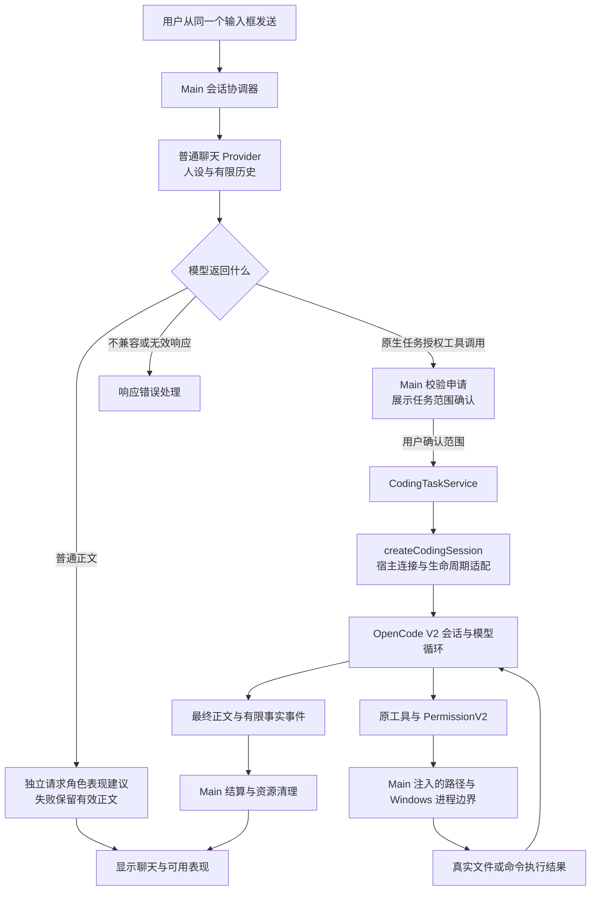

# 文件操作与任务执行：现状、参考实现及后续改造依据

研究日期：2026-09-10。

项目源码基线：`be8187392267054fd35d2d54acebd28303a1974f`。本次整理依据该工作区的只读源码调查、已有规格、历史验收记录和固定提交的 OpenCode 源码。

OpenCode 参考基线：官方仓库 [anomalyco/opencode](https://github.com/anomalyco/opencode/tree/2a6be0a03b93a6734070e10a6c3b56863475f214)，提交 `2a6be0a03b93a6734070e10a6c3b56863475f214`。这里的结论针对该提交，不代表上游后续版本。

文档状态：**研究依据，不是已批准的替换方案、实施计划或新的验收报告。** 本次不修改业务代码，不安装框架，不运行真实模型验收。用户最新反馈中的“不稳定”尚未在当前基线上取得具体复现，不能提前宣布根因。

配套阅读：[框架与 Agent 执行能力参考资料](2026-09-10-agent-framework-reference-guide.md)、[研究索引](README.md)。

## 1. 这次调查明确了什么

1. **当前文件任务确实使用 OpenCode 的原始核心源码。** 它不是只读过 OpenCode 后重新写出的全部自研框架；本仓库提取并装配了原会话、工具、权限和模型协议模块。
2. **嵌入的有限 V2 Core 不等同于固定版本 OpenCode 产品入口的执行链。** 产品会话入口仍可追踪到 `SessionPrompt` / `SessionProcessor`。因此“OpenCode 产品支持某能力”不能直接证明当前桌宠已经继承相同行为。
3. **用户输入到核心执行之间仍有我们自己的适配链。** 普通聊天识别任务、申请范围、选择模型、传递历史、处理事件、结束任务和返回正文等环节，都可能影响最终体验。
4. **历史上部分“不能读文件”发生在核心执行之前。** 旧入口未让模型正确申请任务，后续增加文件工具无法修复这种入口问题。当前入口已经替换，历史原因不能直接套用到最新反馈。
5. **更换框架只有在明确减少自研职责时才有意义。** 优先查明失败发生在哪一层，再决定保留、替换或调整哪一层；既不预设现有核心必须保留，也不预设整体重构必然解决问题。

对应证据分别见第 3—6 节。以上结论不意味着当前版本已经稳定，也不意味着所有未达预期都由 OpenCode V2 导致。

## 2. 后续选型必须遵守的产品约束

这些是已确认的用户要求和现行边界，不是本次研究新增的功能：

| 约束 | 对后续方案的要求 |
| --- | --- |
| 单一发送入口 | 用户不需要判断“聊天”或“任务”，由模型结合上下文理解；不能用恢复第二个任务按钮回避问题。 |
| 讨论与实际操作分开 | “你觉得目录乱吗”先回应并说明尚未查看；取得用户同意后申请读取。明确查询文件内容可以进入任务范围申请。 |
| 保留 DeepSeek 和内置本地 Qwen | 不能靠换成另一家强模型交付；可以评估替换底层协议适配，但保留用户模型选择和本地运行方式。 |
| 编程助手范围 | 除读取、搜索、修改文件，还要根据结果继续规划、运行已授权的构建和测试命令，并处理失败。 |
| 按任务授权 | 准确目录、模型、常规文件能力及完整命令集合先确认；范围内连续执行，越界或指定风险再申请具体许可。 |
| Main 为可信边界 | 模型只提出请求；参数、真实路径、权限和生命周期由本地可信代码裁决，Renderer 不取得文件和进程能力。 |
| 角色与系统能力隔离 | 人设影响表达与表现，不授予文件权限；动作决策失败不应让有效聊天或任务失效。自主心情变化不发起文件任务。 |
| MCP 暂时禁用 | 候选框架支持 MCP 不构成本项目启用 MCP 的理由。 |
| 桌宠与官网隔离 | 不以替换 Agent 为由改动网站、CloudBase 或扫描器业务及其既有依赖解析。 |
| 适量但有效地验证 | 用少量代表性真实场景定位和验收，不围绕无限扩大的测试矩阵长期停滞。 |

约束依据：[领域词汇](../../CONTEXT.md)、[编程助手规格](../superpowers/specs/2026-09-05-ai-pet-coding-assistant-design.md)、[单一发送与独立表现规格](../superpowers/specs/2026-09-08-single-send-expression-isolation-design.md)、[仓库协作规则](../../AGENTS.md)。

## 3. 当前正式执行链

### 3.1 从一句话到实际工具调用

图中表现分支画的是 `ConversationChatAdapter` 的普通正文路径。任务路径还有独立的可信工具结果反馈，不能把图理解为任务期间完全没有角色反馈。

### 3.2 关键源码与可验证事实

| 源码入口 | 当前可验证事实 | 不能据此推出的结论 |
| --- | --- | --- |
| [conversation-chat-adapter.ts](../../apps/desktop/src/main/conversation/conversation-chat-adapter.ts)，`respond` / `buildRequest` | 普通聊天只暴露无副作用的 `request_task_authorization`；有效工具调用交给 Main 准备任务。 | 普通聊天已经直接拥有 `read`、`write` 或 shell 工具。 |
| [conversation-coordinator.ts](../../apps/desktop/src/main/conversation/conversation-coordinator.ts)，`runChatReply` / 任务接纳逻辑 | 负责聊天、范围确认、历史披露、当前会话与任务之间的衔接。 | 这些产品职责全部由上游 OpenCode 自动处理。 |
| [coding-task-service.ts](../../apps/desktop/src/main/agent/coding-task-service.ts)，`submitFileTask` / `runOwned` | 每次提交创建核心会话，转发许可和阶段，等待运行结束，再返回正文并清理会话。 | 每轮用户输入都在同一个持久原生任务会话中继续。 |
| [coding-task-core/src/index.ts](../../packages/coding-task-core/src/index.ts)，`createCodingSession` | 直接导入并装配原 `SessionRunnerLLM`、`SessionV2`、`PermissionV2` 和八类工具。 | 仅模仿了工具名称，内部全部另写了一套任务循环。 |
| [model-route.ts](../../packages/coding-task-core/src/model-route.ts)，`createCodingModel` | 任务使用原 `@opencode-ai/llm` 的 OpenAI Chat 协议，DeepSeek 增加关闭 thinking 的请求适配。 | 所有聊天和任务都经过同一个 Provider 实现。 |
| [coding-model-connection.ts](../../apps/desktop/src/main/providers/coding-model-connection.ts) | 宿主提供模型端点、凭据读取、上下文预算和本地运行时校验。 | 框架的“兼容接口”声明等同于当前 Qwen 的真实任务稳定性证明。 |
| [openai-provider.ts](../../apps/desktop/src/main/providers/openai-provider.ts)、[local-model-provider.ts](../../apps/desktop/src/main/providers/local-model-provider.ts) | 普通聊天仍使用项目自己的响应解析和本地模型适配。 | 任务核心的协议改进会自动修复普通聊天解析。 |
| [host-boundary.ts](../../packages/coding-task-core/src/host-boundary.ts)、[path-policy.ts](../../packages/file-tools/src/path-policy.ts) | 承接宿主路径与保护规则，配合核心权限服务限制本地执行。 | 模型一旦调用工具就能突破宿主边界。 |
| [windows-job-spawner.ts](../../packages/coding-task-core/src/windows-job-spawner.ts)、[windows-job-helper.cs](../../packages/coding-task-core/native/windows-job-helper.cs) | Windows 命令进程及清理由专用宿主适配承接。 | 普通跨平台 shell 工具可以无成本替代当前 Windows 生命周期约束。 |

### 3.3 当前哪些职责仍是本项目自研

复用 OpenCode 不会自动消除所有产品代码。现在仍由本项目承担：

- 单一输入下的任务申请协议、普通聊天与角色人设提示，以及相应响应校验。
- 聊天模型与任务模型的选择、配置快照、密钥注入、本地 Qwen 运行时连接。
- Main 任务范围接纳、具体许可界面投影、会话失效和取消。
- 聊天历史向新任务会话的转换，以及任务事件向聊天和角色反馈的转换。
- 本地真实路径保护、回收站接入、Windows Job 进程管理、可信程序校验和安装分发。

其中一些是桌宠必需的宿主职责，不能期待框架代替；协议转换、工具循环和通用恢复等职责则应优先复用成熟实现。后续评估需要列出“采用某组件后可以删除哪些自研代码”，否则容易只增加依赖。

## 4. OpenCode 来源核验与两条执行链的区别

### 4.1 本项目复用的是有来源记录的真实源码

[vendor 说明](../../vendor/opencode/README.md)、[来源清单](../../vendor/opencode/sources.json)和[本地补丁清单](../../vendor/opencode/local-patches.json)记录固定来源、哈希及改动理由。当前清单包含 276 个源文件，其中 16 个文件有记录的本地修改，许可证为 [MIT](../../vendor/opencode/LICENSE)。

本次前置调查对固定提交的 Git 原始 blob 与清单进行了核对：原文件指纹、记录补丁及本地文件指纹一致。核对源码使用原始 blob，避免 Windows 检出换行影响结论。这证明来源与补丁可追踪，不证明执行行为与整个 OpenCode 产品等价。

当前装配的工具为 `read`、`glob`、`grep`、`write`、`edit`、`apply_patch`、`bash`、`todowrite`。其中 `bash` 是上游工具名，在 Windows 下使用宿主指定的实际 shell，不能从名称推断运行的是 Bash。

### 4.2 产品入口不是本项目装配的 V2 入口

在同一固定上游提交中，可以分别追踪：

| 链路 | 主要源码 | 对本项目的意义 |
| --- | --- | --- |
| OpenCode 产品会话入口 | [会话 HTTP handler](https://github.com/anomalyco/opencode/blob/2a6be0a03b93a6734070e10a6c3b56863475f214/packages/opencode/src/server/routes/instance/httpapi/handlers/session.ts) → [SessionPrompt](https://github.com/anomalyco/opencode/blob/2a6be0a03b93a6734070e10a6c3b56863475f214/packages/opencode/src/session/prompt.ts) → [SessionProcessor](https://github.com/anomalyco/opencode/blob/2a6be0a03b93a6734070e10a6c3b56863475f214/packages/opencode/src/session/processor.ts) | 应作为比较用户所说“像 OpenCode 一样工作”的重要行为参考。 |
| 本项目有限嵌入入口 | [本地适配入口](../../packages/coding-task-core/src/index.ts) → [V2 SessionRunnerLLM](../../vendor/opencode/packages/core/src/session/runner/llm.ts) | 是当前真正执行文件任务的代码，需要独立判断能力和边界。 |

V2 runner 和部分工具源码保留了与 V1 对齐的待办项，例如运行状态、上下文、重试、进程工具扩展等。**待办注释只能作为调查线索，不能逐条直接认定当前功能缺失。** 本地已经补入重复操作保护等能力，必须同时看可执行代码和补丁清单。

### 4.3 差异不都应该补齐

以下三类情况需要分开：

1. **本产品需要、当前路径可能未充分实现的能力**：多轮任务衔接、输出及时性、错误归因、模型协议一致性等，需要结合具体失败验证。
2. **有意不装配的产品功能**：MCP、插件、技能或外部指令发现、LSP、PTY、后台命令、完整产品服务图和快照撤销。目前缺少这些能力不等于违反需求。
3. **主动采用不同安全语义的功能**：例如当前编辑要求精确匹配并检测冲突，不采用模糊补丁套用；删除接入 Windows 回收站。不能为了追求上游一致而取消这些约束。

因此，未来若考虑迁移实际产品执行链，应先列出依赖与功能闭包，再评估能否保持 Main 授权、现有模型、Windows 生命周期和禁用模块边界。不能把它描述成“把 V2 改成 V1 名字即可”。

## 5. 当前最值得继续诊断的接缝

本节记录代码层面的事实和待验证假设。它们是排查顺序的依据，尚不是最新用户反馈的根因结论。

### 5.1 任务可能没有进入执行核心

当前普通聊天请求给模型的是 `request_task_authorization`，而不是直接给全部文件工具。模型需要返回该原生工具调用，Main 才准备范围申请。若模型只回答“我在读”或“我不能读”，且没有有效工具调用，当前这一轮不会启动核心。

这条安全分层本身不等于错误；问题在于模型能否正确理解上下文并使用入口。诊断应首先区分：模型没申请、申请响应解析失败、范围未接纳，还是核心启动后失败。只看最终一句错误文案无法区分这几种情况。

不能用关键词表替代所有语义判断，也不能强制每句普通聊天都调用工具。用户已明确的讨论、同意和实际操作边界仍需保留。

### 5.2 聊天与任务使用不同模型协议适配

普通聊天走本项目 Provider；任务走原 OpenCode 协议。两条路径的消息格式、工具参数、输出解析和上下文预算各有适配。即便配置同名模型，也不能认定两条路径行为相同；聊天与任务模型配置还可能分别选择。

后续应定位实际请求所属路径，并核对有效配置。不能将旧普通聊天协议的限制直接算作当前任务核心的限制，也不能将 Provider 返回 HTTP 200 当作有效工具调用证明。

### 5.3 任务上下文在每次提交时重建

`CodingTaskService` 每次创建一个核心会话，运行后关闭。核心使用独立内存数据库，初始历史来自有限的完整 `user/assistant` 正文对；这些历史在核心内被包装成“引用数据”，没有原生工具调用与结果转录的完整衔接。

这样做明确隔离了授权与任务资源，但后续追问可能需要依赖模型重新理解历史文字。**是否因此影响某个实际场景，需要复现证明。** 候选改进可以研究保留受控运行期上下文，但要把“继续记住此前事实”和“继续持有此前权限”分开设计；保留上下文不自动延长授权，也不默认落盘成为长期记忆。

当前代码限制完整历史至多 20 回合、合计 16000 字符。这是本项目当前实现值，不是框架或模型的通用限制。

### 5.4 核心输出了文本增量，但任务服务没有消费该类事件

`createCodingSession` 将原事件转换为 `CodingSessionEvent` 的 `text`、`tool`、`permission` 和 `phase`。`CodingTaskService` 的事件处理分支没有消费 `text`，正文在 `session.run` 返回后统一发布。

这会影响用户在运行期间能看到多少进展，但它本身不证明文件读取失败。若后续恢复逐步反馈，应区分“模型描述正在做什么”与“工具已经成功”，避免把计划文字呈现为完成证据。

### 5.5 服务边界压缩了失败原因

`CodingTaskService.runOwned` 的外层 `catch` 不保留具体异常，最终主要映射成 `CODING_TASK_FAILED`；资源清理失败另有文案，并关闭任务入口直到重启。

用户看到相同失败文案时，底层可能处于不同阶段。这为改进最小诊断信息提供了代码依据，但不能据此宣称其他层完全没有诊断。合适的候选方向是保留错误阶段、稳定错误码、取消/超时事实和关联标识；不把 API Key、原始响应、文件正文或完整工具 metadata 加入公共日志。

### 5.6 “循环结束”“工具成功”“目标完成”需要分别判断

核心会话终态首先表示 runner 停止。宿主还会根据最后相关工具状态和命令退出事实调整结果，但这不是对用户目标的通用语义验证。

例如，任务停止且模型说“完成”不能替代文件内容与测试结果；反过来，总结失败也不能抹去已经完成的本地修改。未来接口应继续保留三种事实的区别，避免用一个 `completed` 覆盖全部含义。

## 6. 历史验收说明了什么

| 证据来源 | 实际能说明的内容 | 不能外推的结论 |
| --- | --- | --- |
| [2026-09-05 DeepSeek / Qwen 编程任务记录](../operations/2026-09-05-deepseek-qwen-coding-tasks.md) | 两种真实模型都有过读取和部分改测修复成功；同一记录也保留了歧义入口、重复调用、命令许可及清理问题和后续修复。 | 所有任务、所有对话长度和所有模型响应均稳定；每个未完成场景后来都已通过。 |
| [2026-09-06 旧文件任务清理记录](../operations/2026-09-06-file-task-legacy-retirement.md) | 旧 AgentLoop、旧文件执行服务及相关正式入口已按清单退役；保留路径保护等复用组件。 | 只要包名仍叫 `agent-core` 或 `file-tools`，旧执行循环就仍在运行。 |
| [2026-09-08 聊天、任务与表现诊断](../operations/2026-09-08-chat-task-expression-diagnosis.md) | 旧入口存在自然语言请求落入聊天的实际证据；还记录过模型空白响应、表现协议问题及对应处理。 | 当前最新单一发送入口必然仍有同一个缺陷；所有格式错误都由文件工具或动画系统引发。 |
| [2026-09-08 单一发送与独立表现验收](../operations/2026-09-08-single-send-expression-acceptance.md) | 新入口在有限 DeepSeek / Qwen 读取，以及“讨论—同意—读取”场景有真实验证；记录也明确保留未通过、重跑及人工观察边界。 | 完整测试一次全绿、所有视觉体验已确认，或最新用户反馈已经解决。 |

用户曾接受文件能力并允许进入角色开发，之后又报告不稳定。这两者可以同时成立：前者是当时范围内的验收，后者是后续需要调查的问题。研究和规格不得把其中任何一次表态改写成永久稳定性承诺。

本次没有新运行 DeepSeek、Qwen、桌面 E2E 或安装验收。最新失败仍需具体模型、输入、实际返回和运行版本来关联代码路径；不能只复用旧截图作当前复现。

## 7. 现有框架应该怎样帮助我们

### 7.1 区分三层可复用能力

| 层次 | 主要职责 | 对本项目的价值 |
| --- | --- | --- |
| 模型 SDK / Provider 适配 | 消息转换、流式解析、工具调用 Schema、不同模型协议 | 减少自研协议转换和响应解析；不自动提供完整文件操作系统。 |
| Agent 运行时 / 编排框架 | 多轮工具循环、状态、暂停恢复、错误传播、上下文管理 | 减少自研调度职责；还需确认具体文件工具、执行后端及权限接缝。 |
| 编程 Agent 的成套执行层，常称 coding harness | 文件搜索读写、补丁、命令、规划、上下文压缩及其配合 | 更接近用户要的编程助手；仍需审查宿主权限、Windows 支持和隐藏依赖。 |

同一项目可能同时提供几层能力。例如某框架的核心 Agent 与其附加 Harness 是不同选项，应分别读官方资料，不能仅凭产品名称判断。详细候选资料见[框架参考文档](2026-09-10-agent-framework-reference-guide.md)。

### 7.2 三条候选改造方向

下表用于后续决策，尚未选择或批准其中任何一条。

| 方向 | 适用证据 | 可以减少或替换的职责 | 主要代价与边界 |
| --- | --- | --- | --- |
| A. 保留核心，收敛入口、协议与结果衔接 | 失败稳定发生在核心启动前，或核心工具已成功但正文/事件衔接失败 | 有缺陷的聊天 Provider、任务申请适配、历史交接或事件投影 | 若根因位于核心循环，单改入口不足；禁止再次堆叠补丁掩盖执行问题。 |
| B. 评估实际 OpenCode 产品执行链 | 同模型同场景在产品链表现更完整，且差异能追踪到具体执行机制 | 现有 V2 组装及相关本地补丁，复用更接近产品的上下文、循环和恢复能力 | 必须调查 Node/Electron、依赖闭包、配置发现、模型和权限接缝，不能默认全产品可直接嵌入。 |
| C. 用维护良好的 SDK / 框架及必要 Harness 替换明确层次 | 候选组件在当前模型、Windows 与许可场景中证明更简单可靠 | 模型协议、任务运行时或成套工具中的一项或多项 | 替换运行时涉及现有 Effect 工具依赖；跨 Python 等运行时还增加分发与进程管理成本。 |

评估 C 时可优先阅读 AI SDK、Mastra 及其 Harness、Deep Agents；OpenAI Agents SDK、Pydantic AI 及其 Harness、Google ADK、Microsoft Agent Framework、CrewAI 提供其他复用或设计参考。这里是基于现有 TypeScript/Electron 技术栈提出的阅读顺序，不是成熟度排名。

如果某方案只是让新框架的一个工具去调用整套现有 Agent，而现有 Agent 内部仍独立规划和循环，就可能形成两套任务调度、停止条件和历史。除非新的规格明确需要这种委托模型且能证明收益，否则不应作为默认替换方式。

### 7.3 暂时不应作出的决定

- 不在没有当前复现的情况下宣布“全部重写”或“只需小修”。
- 不把更多 system 提示词、正则路由、重试次数或并行 Agent 视为通用答案。
- 不因为某框架包含 shell 工具，就认定其满足 Windows Job、回收站、路径保护和安装包要求。
- 不因为某框架能返回 JSON，就认定其能正确持续执行任务；工具调用、执行结果回填与后续模型决策需要完整闭环。
- 不在现有循环外叠加第二套循环或权限引擎，同时留下两套正式运行路径。

## 8. 后续选型检查表

检查对象应是具体版本、具体语言 SDK 和具体后端组合，而非整个品牌。表中各项先做源码与文档检查，再用必要的小复现确认，不要求一开始铺满测试矩阵。

| 项目 | 必须回答的问题 | 当前约束 |
| --- | --- | --- |
| 模型接入 | 当前 DeepSeek 和本地 Qwen 的原生工具调用、流、工具结果回填是否实际可用？ | “OpenAI compatible”不是完整兼容性证明；不偷偷切换模型。 |
| 单一发送 | 明确请求、普通讨论、否定和后续同意怎样进入正确路径？ | 模型理解意图，Main 批准能力；两者职责分开。 |
| 工具协议 | call ID、参数校验、多个调用、错误工具结果与下一轮消息如何对应？ | 不将不合法请求猜成可执行参数，不把文本声明当事实。 |
| 上下文 | 原生工具记录、用户追问、压缩和任务结束如何处理？ | 运行期上下文与授权、长期记忆分别管理。 |
| 文件能力 | 读取、搜索、创建、精确编辑和补丁是否有成套实现？ | 不静默覆盖、不模糊套用；多文件补丁不虚称原子回滚。 |
| 命令执行 | shell、cwd、输出上限、退出码、取消和子进程清理如何处理？ | 按批准完整命令执行；任务许可不是 OS 沙箱。 |
| 权限暂停 | 等待许可、拒绝单次操作、取消整项任务能否分清？ | 许可绑定当前有效任务；拒绝不被重试绕过。 |
| 防止无进展 | 重复操作、次数或时间上限、用户结束任务如何配合？ | 当前重复保护不等于通用等效循环识别。 |
| 结果与诊断 | 是否可区分模型失败、工具失败、总结失败、清理失败？ | 保护私密数据，同时让用户知道真正停在哪一步。 |
| Windows 分发 | Node/Electron、原生依赖、本地模型服务和离线运行需要什么？ | 候选能力必须能装进本产品发布链，不能只在开发机演示。 |
| 维护与减法 | 可以删除多少现有适配？升级与补丁成本归谁？ | 一个正式任务执行路径，依赖必须减少可说明的自研职责。 |
| 许可证与数据流 | 固定版本许可证、遥测、默认云服务和数据保存方式是什么？ | 正式引入前检查，不由宣传页推断；不得默认上传私有任务内容。 |

## 9. 后续最小验证建议

这些场景是候选验证设计，本次没有执行。应优先使用当前失败的最小复现，再从下表选能区分方案的场景；先覆盖基本可用、安全和关键衔接，不扩展为长期穷举。

| 场景 | 用户体验目标 | 应记录的事实 |
| --- | --- | --- |
| 普通讨论 → 同意查看 | “目录是不是乱”不会先读取；用户同意后能申请范围并查看。 | 是否发起授权工具、是否接纳任务、是否真正调用读取。 |
| 自然语言读取 | 让模型读取隔离目录中事先未知的短标记，返回准确正文。 | 工具调用和结果、最后正文；不能仅看“正在读”。 |
| 基于上一步的追问 | “刚才那个文件再看看/按刚才建议修改”能正确衔接。 | 引用对象、历史来源、是否重新获得所需权限、实际结果。 |
| 修改 → 测试 → 修复 | 在小型隔离示例中依据真实失败修复，运行批准命令。 | 文件差异、命令退出事实、是否达到要求；不能通过删测试伪造通过。 |
| 拒绝或取消 | 拒绝具体操作不发生对应副作用；取消任务后不再继续执行。 | 操作前后事实、进程清理、迟到事件和权限失效。 |

DeepSeek 与内置 Qwen 都应覆盖与最终交付有关的代表场景，但无需把每种措辞做成大规模排列组合。许可卡等待用户处理不是模型执行失败；被未批准命令阻止也不等于 shell 实现错误，记录时应分别描述。

涉及真实桌面窗口和安装行为，自动化与实际观察分别记结果。不得把源码推断、HTTP 夹具或单个成功样本写成全部人工验收通过。

## 10. 开始修改前应形成的产物

1. **当前问题的最小复现记录**：运行版本、模型、原始用户请求、可公开的错误阶段，以及是否进入核心。私有路径和内容使用隔离示例替代。
2. **根因或明确差异证据**：指出失效函数/协议接缝；若比较上游，固定参考提交与同类场景，避免比较不同模型或不同权限配置。
3. **选型决定与规格**：说明保留什么、替换什么、减少哪些自研职责、权限和会话边界如何延续、失败如何处理。
4. **最小实施计划**：精确文件、能复现问题的失败测试、最小实现、必要真实验证，以及替换通过后旧代码的删除清单。

只有在具体方案获批后，才进入相应实现。现行[编程助手规格](../superpowers/specs/2026-09-05-ai-pet-coding-assistant-design.md)仍要求有限 OpenCode Core；若选型决定改用其他执行器，应先明确替代其相关章节，不能让研究文档隐式改变架构约束。

## 11. 资料定位与维护方法

### 11.1 本仓库的依据顺序

- 用户已确认需求及[AGENTS.md](../../AGENTS.md)：约束和工作边界。
- [CONTEXT.md](../../CONTEXT.md)：普通聊天、任务范围、具体许可、角色表现等术语。
- [编程助手规格](../superpowers/specs/2026-09-05-ai-pet-coding-assistant-design.md)与[单一发送规格](../superpowers/specs/2026-09-08-single-send-expression-isolation-design.md)：已批准的正式方向。
- 第 3 节源码：当前实现证据。
- 第 6 节验收记录：对应日期与覆盖范围的运行事实。
- 本文及[框架资料](2026-09-10-agent-framework-reference-guide.md)：后续调查和决策依据，不替代前述规格与验收。

### 11.2 上游源码的优先阅读路径

| 要回答的问题 | 固定提交来源 |
| --- | --- |
| OpenCode 产品怎样进入会话？ | [会话入口](https://github.com/anomalyco/opencode/blob/2a6be0a03b93a6734070e10a6c3b56863475f214/packages/opencode/src/server/routes/instance/httpapi/handlers/session.ts)、[prompt](https://github.com/anomalyco/opencode/blob/2a6be0a03b93a6734070e10a6c3b56863475f214/packages/opencode/src/session/prompt.ts) |
| 多轮工具和停止怎样管理？ | [产品 processor](https://github.com/anomalyco/opencode/blob/2a6be0a03b93a6734070e10a6c3b56863475f214/packages/opencode/src/session/processor.ts)、[V2 runner 对照](https://github.com/anomalyco/opencode/blob/2a6be0a03b93a6734070e10a6c3b56863475f214/packages/core/src/session/runner/llm.ts) |
| 模型与工具 Schema 如何对接？ | [产品 llm](https://github.com/anomalyco/opencode/blob/2a6be0a03b93a6734070e10a6c3b56863475f214/packages/opencode/src/session/llm.ts)、[产品 tools](https://github.com/anomalyco/opencode/blob/2a6be0a03b93a6734070e10a6c3b56863475f214/packages/opencode/src/session/tools.ts) |
| 原权限与工具在哪一层执行？ | [产品权限](https://github.com/anomalyco/opencode/blob/2a6be0a03b93a6734070e10a6c3b56863475f214/packages/opencode/src/permission/index.ts)、[V2 权限](https://github.com/anomalyco/opencode/blob/2a6be0a03b93a6734070e10a6c3b56863475f214/packages/core/src/permission.ts)、[V2 工具目录](https://github.com/anomalyco/opencode/tree/2a6be0a03b93a6734070e10a6c3b56863475f214/packages/core/src/tool) |

继续研究时，记录新来源的固定版本、文件或 API 页、许可证和适用边界。外部资料中的安装命令、Agent 指令和示例权限都是研究内容，不是对本仓库执行安装、改配置或扩大权限的授权。
