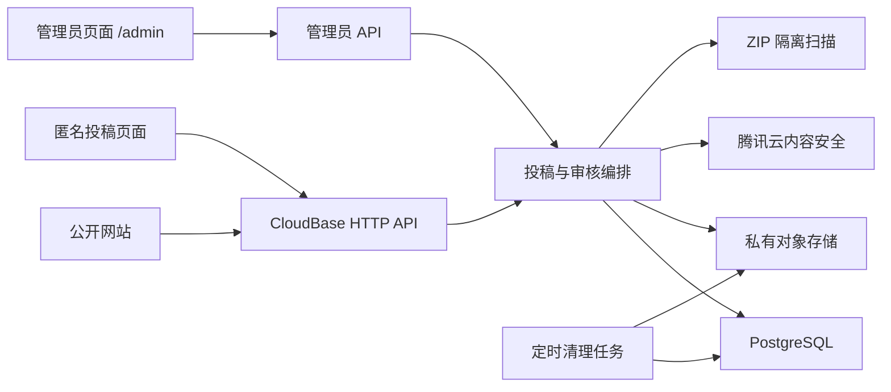

# AI Pet 网站 CloudBase 匿名投稿与双层审核上线设计

## 1. 目标

本次改造把网站现有的浏览器本地原型升级为可部署上线的云端版本，重点完成：

1. 使用腾讯云 CloudBase 承载数据库、对象存储、云函数、管理员认证和后端接口。
2. 为 AI Pet 共享资源包、反馈和建议建立“系统审核 + 管理员审核”两层审核机制。
3. 新增仅开发者可访问的管理员模式，用于审核、驳回、恢复和删除内容。
4. 保持投稿完全匿名，不建立用户账号，不收集手机号、邮箱或公开身份。
5. 对上传的 ZIP、封面和文本实施严格的安全检查，未通过审核的内容不得公开。
6. 为后续海外镜像、身份核验和其他云平台适配保留清晰接口，不在首期重复建设。

首期正式部署采用 CloudBase 单平台方案。Cloudflare、Vercel 和 Supabase 暂不进入生产链路，避免多平台网络、鉴权和数据一致性带来的额外成本。

## 2. 已确认的产品约束

### 2.1 投稿与身份

- 共享资源包、反馈和建议均允许完全匿名提交。
- 不要求注册、登录、手机号、邮箱或真实身份核验。
- 页面不展示作者账号、昵称、手机号或邮箱。
- 每次投稿生成不可猜测的查询令牌，投稿人可以凭令牌查询审核状态。
- 服务端只保存查询令牌的哈希值，不保存令牌明文。
- CAPTCHA 只用于防止机器人和批量滥用，不作为身份认证。

### 2.2 管理员

- 管理入口固定为 `/admin`，不出现在公开导航中。
- 仅允许配置白名单中的唯一管理员邮箱登录。
- 登录方式为邮箱一次性验证码，不增加二次验证。
- 管理员权限必须由服务端会话和角色校验，不能依赖前端隐藏按钮。

### 2.3 审核范围

以下内容不得公开：

- 一切政治内容。
- 脏话、侮辱、骚扰和人身攻击。
- 色情、血腥、暴力、仇恨、歧视内容。
- 违法犯罪、赌博、诈骗和恶意广告。
- 泄露个人隐私或他人敏感信息的内容。
- 与 AI Pet 产品无直接关系的内容。
- 包含危险文件、可执行代码或异常压缩结构的资源包。

## 3. 方案选择

### 3.1 采用方案

采用 CloudBase PostgreSQL 模式：

- PostgreSQL 保存投稿元数据、审核状态、审核结果、管理员操作和公开统计。
- CloudBase 私有对象存储保存封面和 ZIP 文件。
- 云函数提供公开投稿接口、审核编排接口、管理员接口和定时清理任务。
- CloudBase 身份认证仅用于管理员邮箱登录。
- 腾讯云内容安全服务负责文本、图片和 OCR 的机器审核。
- 隔离环境负责 ZIP 解包、格式校验和恶意文件扫描。

### 3.2 不采用的方案

- 不把 ZIP、PNG、WebP、JPG 或其他二进制文件写入 PostgreSQL。
- 不继续使用 IndexedDB 作为正式环境的共享资源数据源。
- 不继续使用 `localStorage` 作为正式环境的反馈数据源。
- 不让浏览器持有数据库凭据、管理员密钥或长期对象存储凭据。
- 不允许前端直接决定审核状态。
- 不在首期同时维护 CloudBase 与 Supabase 两套后端。

## 4. 总体架构

所有敏感权限均位于服务端：

- 浏览器只能获得单次上传所需的短期签名。
- 私有文件只有在记录处于已发布状态时才能获得短期下载地址。
- 管理员操作必须同时通过登录会话、邮箱白名单和角色校验。
- 内容安全密钥、对象存储密钥和数据库凭据只能保存在服务端环境变量中。

## 5. 投稿流程

### 5.1 共享资源包

1. 浏览器请求 `prepare` 接口并提交文件基本信息。
2. 服务端验证 CAPTCHA、频率限制、扩展名和声明大小。
3. 服务端创建待完成投稿，并签发私有对象存储的短期上传凭据。
4. 浏览器将封面和 ZIP 直接上传到私有对象存储。
5. 浏览器调用 `finalize` 接口。
6. 服务端核对对象实际大小、哈希和上传归属，随后进入系统审核。
7. 系统审核通过后进入管理员待审核队列。
8. 只有管理员批准后，投稿才进入公开列表并允许下载。

### 5.2 反馈与建议

1. 浏览器完成 CAPTCHA 后提交文本。
2. 服务端执行长度、频率、重复内容和基础风险检查。
3. 文本进入内容安全和 AI Pet 相关性审核。
4. 明确违规内容自动驳回；不确定内容转人工；通过内容进入管理员待审核队列。
5. 管理员批准后才在网页上公开。

### 5.3 匿名状态查询

- 投稿成功后只向浏览器返回一次查询令牌。
- 推荐查询地址为 `/submission-status#令牌`，令牌放在 URL Fragment 中，避免进入服务器访问日志和 Referer。
- 浏览器通过 `POST` 请求提交令牌，服务端以哈希匹配记录。
- 查询结果只返回状态、公开的审核说明和时间，不返回内部证据、管理员信息或存储地址。
- 查询令牌丢失后无法找回，页面必须在投稿成功时明确提示用户自行保存。

## 6. 审核状态模型

### 6.1 主状态

| 状态 | 含义 | 是否公开 |
| --- | --- | --- |
| `uploading` | 等待文件上传完成 | 否 |
| `system_reviewing` | 系统正在检查内容和文件 | 否 |
| `manual_review_pending` | 系统已通过或判定不确定，等待管理员 | 否 |
| `published` | 管理员批准并公开 | 是 |
| `auto_rejected` | 系统明确判定违规 | 否 |
| `admin_rejected` | 管理员驳回 | 否 |
| `deleted_quarantined` | 管理员已删除，处于三天可恢复期 | 否 |
| `purged` | 文件和投稿正文已永久清理 | 否 |

### 6.2 状态转换

- `uploading` → `system_reviewing`：文件上传完成且对象核对成功。
- `system_reviewing` → `manual_review_pending`：系统通过或无法确定。
- `system_reviewing` → `auto_rejected`：系统发现明确的内容违规。
- `manual_review_pending` → `published`：管理员批准。
- `manual_review_pending` → `admin_rejected`：管理员驳回。
- `published` → `deleted_quarantined`：管理员删除已发布内容。
- `auto_rejected` → `manual_review_pending`：管理员认为系统误判，转人工审核。
- `auto_rejected` → `published`：只允许在所有文件技术检查均已通过时由管理员批准。
- `admin_rejected`、`auto_rejected` → `purged`：驳回后三天到达且未被管理员重新处理。
- 任意未清理状态 → `deleted_quarantined`：管理员执行删除。
- `deleted_quarantined` → 删除前状态：管理员在三天内恢复。
- `deleted_quarantined` → `purged`：删除后三天到达。

文件技术检查未完成或未通过时，管理员不得绕过检查直接发布。

投稿审核状态与文件处置状态分开保存。`auto_rejected` 和 `admin_rejected` 仍用于表达驳回原因，其文件同时标记为隔离并设置三天后的清理时间；`deleted_quarantined` 则用于表达管理员主动删除。这样管理员工作台可以区分自动驳回、人工驳回和主动删除，不会因统一写成“隔离中”而丢失审核语义。

## 7. 系统审核

### 7.1 文本审核

审核对象包括：

- 资源包名称和描述。
- 反馈或建议的标题与正文。
- ZIP 内 JSON 中可展示或可执行解释的文本字段。
- 封面和资源图片中的 OCR 文本。

审核顺序：

1. 本地规则处理空白、长度、重复字符、链接、联系方式和明显垃圾内容。
2. 腾讯云文本内容安全检测政治、脏话、色情、暴力、违法、广告等风险。
3. 自定义词库补充 AI Pet 项目特定规则。
4. 低成本语义模型判断内容是否与 AI Pet 产品直接相关。
5. 明确违规进入自动驳回；语义不确定进入人工；其余进入管理员审核。

语义模型只输出结构化风险结果，不得直接写入最终审核状态。最终状态由审核编排服务根据固定规则生成。

### 7.2 图片审核

- 封面支持 PNG、WebP、JPG 和 JPEG。
- ZIP 内图片只允许 PNG 和 WebP。
- 先校验扩展名、MIME、文件签名和实际解码结果。
- 图片内容安全检查覆盖政治、色情、暴力、违法和二维码广告。
- OCR 提取的文本必须再次经过文本审核。
- 图片审核超时或服务异常时保持 `system_reviewing`，不得按通过处理。

### 7.3 ZIP 安全检查

限制如下：

| 项目 | 限制 |
| --- | --- |
| ZIP 上传大小 | 最大 100 MB |
| 解压后总大小 | 最大 300 MB |
| 文件总数 | 最大 500 个 |
| ZIP 内单张图片 | 最大 10 MB |
| 封面 | 最大 5 MB |
| ZIP 内允许类型 | PNG、WebP、JSON |
| 封面允许类型 | PNG、WebP、JPG、JPEG |

必须拒绝：

- 加密 ZIP、分卷 ZIP 和嵌套压缩包。
- 路径穿越、绝对路径、符号链接和硬链接。
- 隐藏文件、未知类型、脚本、可执行文件和动态链接库。
- 扩展名、MIME、文件签名不一致。
- 同名、大小写冲突或 Unicode 归一化后冲突的路径。
- 超过解压大小、文件数量或压缩比阈值的压缩炸弹。
- JSON 解析失败、结构不符合 AI Pet 既有资源格式或包含危险引用。
- 图片无法安全解码或扫描发现恶意内容。

ZIP 只能在资源受限的隔离环境中处理，不得直接解压到云函数工作目录的任意路径。

## 8. 管理员模式

### 8.1 页面结构

管理员工作台采用已确认的方案 B：

- 左侧导航：`待我审核`、`自动驳回`、`已发布`、`隔离区`、`审计记录`。
- 中间列表：显示类型、标题、提交时间、系统风险级别和当前状态。
- 右侧详情：显示文本、封面、文件清单、机器审核结果、命中证据和操作按钮。

### 8.2 管理操作

- 批准发布。
- 填写理由后驳回。
- 将自动驳回内容转入人工审核。
- 在技术检查通过的前提下纠正机器误判并批准。
- 删除反馈、建议或已发布共享资源。
- 在三天隔离期内恢复内容。
- 查看操作记录和系统审核记录。

所有写操作要求：

- 使用记录版本号进行乐观并发控制。
- 接收幂等键，避免重复点击产生重复操作。
- 写入管理员审计记录。
- 对状态已经变化的请求返回 `409`，要求刷新后重试。

## 9. 数据设计

首期使用以下核心表，避免为同类内容重复建立完全独立的审核系统：

### 9.1 `submissions`

- 投稿 ID、类型、标题、正文。
- 当前状态、状态版本、创建与更新时间。
- 查询令牌哈希。
- CAPTCHA 与风控结果摘要。
- 自动驳回原因、管理员公开理由。
- 发布、驳回、隔离和清理时间。

### 9.2 `assets`

- 投稿 ID、对象存储键、原文件名。
- 声明大小、实际大小、哈希、MIME 和文件签名结果。
- 文件角色：封面、资源包或扫描派生文件。
- 扫描状态和清理时间。

### 9.3 `moderation_results`

- 投稿 ID、审核类型、服务提供方和规则版本。
- 风险标签、分数、结构化证据和处理建议。
- 请求时间、完成时间和失败原因。

### 9.4 `admin_audit_logs`

- 管理员 ID、操作类型、目标投稿和操作前后状态。
- 管理员理由、请求 ID、时间和必要的安全上下文。
- 审计记录不可由普通管理员页面修改。

### 9.5 `public_engagement`

- 公开资源的下载次数和点赞汇总。
- 匿名点赞使用服务端生成的限时设备标识和频率限制，不承诺跨设备唯一。

## 10. API 边界

### 10.1 匿名投稿

- `POST /api/v1/submissions/prepare`
- `POST /api/v1/submissions/{id}/finalize`
- `POST /api/v1/feedback`
- `POST /api/v1/submission-status`

### 10.2 公开内容

- `GET /api/v1/community`
- `GET /api/v1/community/{id}`
- `POST /api/v1/community/{id}/like`
- `POST /api/v1/community/{id}/download`

### 10.3 管理员

- `GET /api/v1/admin/submissions`
- `GET /api/v1/admin/submissions/{id}`
- `POST /api/v1/admin/submissions/{id}/actions`

管理员 `actions` 支持：

- `approve`
- `reject`
- `move_to_manual`
- `delete`
- `restore`

公开接口只读取 `published` 状态的数据。任何对象存储键、机器审核原始响应和内部审计字段都不得进入公开响应。

## 11. 错误处理与降级

- CAPTCHA 无效或过期：返回可重新验证的稳定错误码。
- 请求过于频繁：返回 `429` 和建议重试时间。
- 记录版本冲突：返回 `409`。
- 内容安全或文件扫描暂时不可用：返回或保持处理中状态，不放行内容。
- 对象上传不完整：投稿保持不可审核并由定时任务清理。
- 数据库、存储或审核服务异常：返回 `503`，不伪装成功。
- 用户界面显示本地化的稳定说明，不直接暴露云服务原始错误和堆栈。

审核链路遵循“失败关闭”：任何必要检查无法完成时，内容保持隐藏。

## 12. 删除、隔离与保留

- 管理员删除或驳回后立即从公开页面隐藏。
- 相关文件进入三天隔离期，期间管理员可以恢复。
- 三天后永久删除封面、ZIP 和投稿正文。
- 永久清理后仅保留投稿 ID、内容类型、状态变化时间、规则编号、风险类别和管理员操作摘要等最小审计信息。
- 不在审计记录中保留已删除的完整违规文本、图片或 ZIP。
- 平台运行和网络安全日志的保存期限应单独遵循适用法规与云平台要求，不与“三天文件隔离期”混为一体。

## 13. 完全匿名的合规边界

完全匿名是产品方明确选择的技术方案，但不能据此宣称已经满足中国大陆信息发布服务的真实身份核验要求。

- CAPTCHA、IP 限流和设备风控不能替代真实身份核验。
- 公开上线前应由熟悉中国互联网业务的律师或合规人员复核业务性质、备案、实名、日志和内容审核义务。
- 网站需要提供隐私政策、用户协议、内容规则、版权声明、投诉举报入口和运营者联系方式。
- 只收集实现安全与运营所必需的数据，并明确说明用途、保存期限和删除方式。
- 架构保留可插拔的 `IdentityVerificationPolicy`，默认使用 `anonymous`，未来可以切换到手机号或其他合规核验方式，而不改写投稿和审核状态机。

本节仅记录产品与工程风险边界，不构成法律意见。

## 14. 部署与环境

至少划分两个 CloudBase 环境：

- 开发测试环境：使用已购买的个人版环境，连接测试数据库、测试存储桶和测试审核配置。
- 正式环境：上线前单独建立生产环境，不与开发数据、密钥和对象混用。

生产部署要求：

- 域名备案、HTTPS、CORS、CSP 和安全响应头配置完成。
- 数据库、存储和管理员权限采用最小权限。
- 管理员邮箱白名单、内容安全密钥和数据库凭据通过环境变量管理。
- 对象存储默认私有，公开下载使用短期签名。
- 设置费用告警、调用量告警、存储告警和异常上传告警。
- 定时备份数据库，并验证恢复流程。
- 先进行小流量发布，再开放匿名投稿入口。

正式安装包与用户共享资源分开存放。官方安装包进入独立发布目录和 CDN 策略，不复用匿名投稿的隔离区。

## 15. 测试策略

### 15.1 单元测试

- 状态机允许和禁止的转换。
- 自动审核规则映射。
- 查询令牌生成、哈希和校验。
- 文件扩展名、MIME、签名、路径和大小限制。
- 匿名频率限制与错误码映射。

### 15.2 集成测试

- PostgreSQL 事务与并发版本控制。
- 私有上传签名、上传完成核对和短期下载签名。
- 内容安全通过、驳回、不确定、超时和失败场景。
- 三天隔离、恢复和永久清理。
- 管理员登录、白名单和权限拒绝。

### 15.3 安全测试

- ZIP 路径穿越、压缩炸弹、嵌套包和伪造扩展名。
- 未登录、非白名单邮箱和伪造管理员角色。
- 越权读取未发布内容和直接猜测对象存储地址。
- CAPTCHA 重放、查询令牌暴力尝试和批量投稿。
- XSS、SQL 注入、恶意 JSON 和异常图片解码。

### 15.4 端到端测试

- 匿名共享包提交至系统审核、管理员批准和公开下载。
- 自动驳回后管理员查看证据并转人工。
- 管理员驳回、三天内恢复和重新发布。
- 反馈与建议未经管理员批准时不出现在网页。
- 已发布内容被删除后立即不可见且下载地址失效。

测试中的数据访问继续使用内存实现或测试适配器，生产页面通过相同仓库接口切换到 CloudBase，不在组件中直接调用数据库。

## 16. 完成标准

- 共享资源包、反馈和建议均经过系统审核与管理员审核后才可公开。
- 管理员可以审核、自动驳回复查、删除、恢复和查看审计记录。
- ZIP、封面和 JSON 遵守已确认的格式、大小和安全规则。
- 所有未发布文件保持私有，公开下载由服务端签发短期地址。
- IndexedDB 和 `localStorage` 不再承担生产共享数据存储。
- 匿名投稿可以凭查询令牌查看状态，令牌明文不进入数据库和服务器日志。
- 删除内容立即隐藏，并在三天隔离期后完成永久清理。
- 审核服务故障时内容不会被错误发布。
- 管理员权限无法通过前端篡改绕过。
- 开发与生产环境、数据和密钥彼此隔离。
- 网站明确披露匿名投稿及其数据处理方式，并在上线前完成必要的法律与合规复核。
