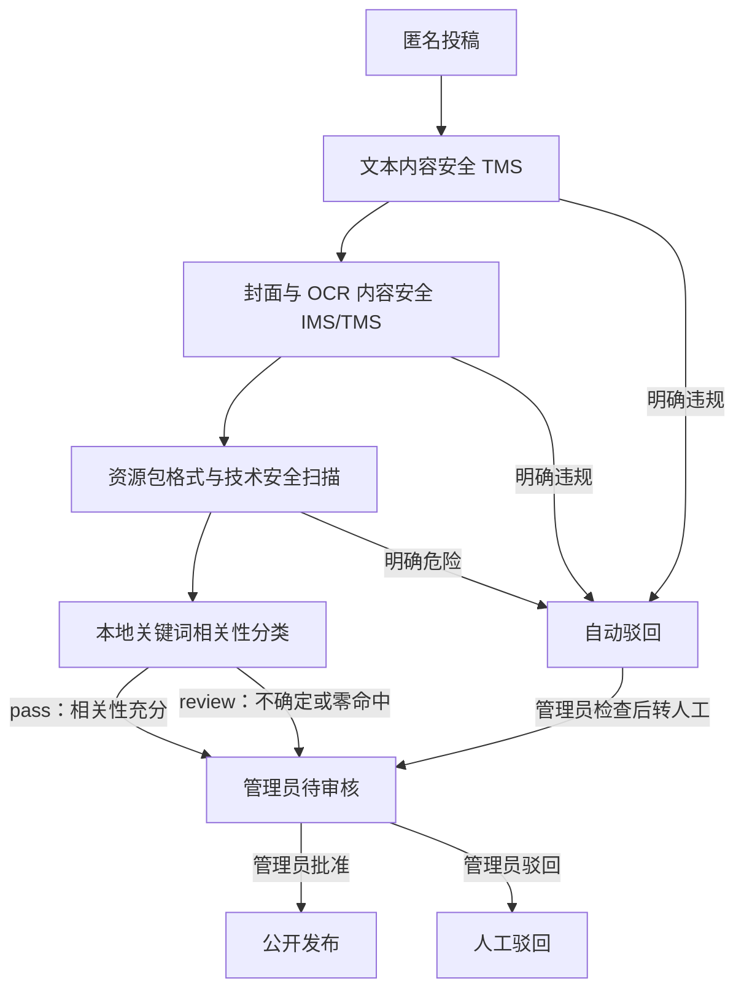

# AI Pet 本地关键词相关性审核设计

## 1. 背景与目标

CloudBase 个人版无法直接使用计划中的大模型相关性审核。为了继续完成开发测试、控制成本，并保持“系统审核后再由管理员审核”的两层审核流程，本次将 AI Pet 相关性判断改为后端本地关键词规则。

本设计的目标是：

1. 不依赖大模型、外部 AI API 或额外付费能力。
2. 对明显与 AI Pet 产品相关的投稿给出系统相关性通过建议。
3. 对零命中、弱命中和无法确定的内容一律转人工，不因关键词不足自动驳回。
4. 保持腾讯云文本、图片、OCR 和资源包技术扫描的明确风险自动驳回能力。
5. 无论相关性结果为通过还是转人工，内容都必须经过管理员批准后才能公开。
6. 以最小修改替换现有大模型分类器，并保留未来重新接入语义模型的接口。

## 2. 设计原则

- **系统审核不等于公开发布**：系统相关性通过只表示可以进入管理员队列，不能直接发布。
- **关键词层不自动驳回**：本地关键词只能输出 `pass` 或 `review`，不得输出 `reject`。
- **不确定时转人工**：零命中、单个弱词、组合不足、解析异常均输出 `review`。
- **明确风险仍可自动驳回**：政治、脏话及其他内容安全风险，以及危险压缩包、非法文件和扫描明确失败，仍由既有安全审核规则处理。
- **失败关闭**：必要的腾讯云内容安全或文件扫描无法完成时，投稿保持隐藏，不得按通过处理。
- **规则可审计**：审核记录写明本地关键词提供方、结论和规则版本，供管理员检查。
- **最小修改**：复用现有 `RelevanceClassifier` 端口、审核编排服务和状态机，不重复建设另一套审核系统。

## 3. 审核链路

本次替换的只有相关性分类步骤。TMS、IMS、OCR、CAPTCHA、资源包技术扫描、管理员审核和三天隔离流程保持原设计。

## 4. 输入与规范化

### 4.1 输入范围

第一版只判断投稿的标题与正文描述，与现有相关性分类器的输入范围一致。封面、OCR 文本和资源包内 JSON 仍由各自的内容安全与技术扫描流程负责，本次不扩大相关性分类范围。

### 4.2 规范化步骤

分类前按固定顺序处理标题与正文：

1. 合并标题与正文，但数据库中的原文保持不变。
2. 使用 Unicode NFKC 规范化全角字符和兼容字符。
3. 英文字母统一转换为小写。
4. 连续空白压缩为单个空格，并去除首尾空白。
5. 中文词按连续文本匹配；英文词按单词边界匹配，避免把 `petroleum` 误判为 `pet`。

规范化只用于规则判断，不覆盖用户原始投稿。

## 5. 关键词分组

### 5.1 强产品词

强产品词可以单独证明内容与产品相关：

- `AI Pet`
- `AI桌宠`
- `桌宠`
- `桌面宠物`
- `desktop pet`

命中任意强产品词时，相关性建议为 `pass`。

### 5.2 资源对象词

- 角色
- 模型
- 皮肤
- 贴图
- 动画
- 动作
- 资源包
- 压缩包
- JSON
- PNG
- JPG
- JPEG
- WebP

### 5.3 产品功能词

- 跟随鼠标
- 拖拽
- 点击互动
- 待机
- 移动
- 缩放
- 透明度
- 置顶
- 开机启动
- 托盘
- 导入
- 上传
- 下载
- 加载

### 5.4 问题与建议词

- 闪退
- 卡顿
- 无法启动
- 导入失败
- 显示异常
- 兼容性
- 建议
- 反馈
- 希望增加
- 能否支持

上述三组均为弱语义组，单独命中一个词不能自动视为相关。

## 6. 判定规则

规则按以下优先级执行：

1. 命中任意强产品词，输出 `pass`。
2. 未命中强产品词，但命中有效跨组组合时，输出 `pass`。
3. 其他情况全部输出 `review`。

第一版有效跨组组合为：

- 资源对象词 + 产品功能词。
- 产品功能词 + 问题与建议词。
- 资源对象词 + 问题与建议词。

典型结果如下：

| 投稿文本摘要 | 命中情况 | 结果 |
| --- | --- | --- |
| “AI桌宠导入新角色后闪退” | 强产品词 | `pass` |
| “PNG 贴图导入后显示异常” | 资源对象 + 产品功能/问题 | `pass` |
| “希望增加拖拽时的透明度设置” | 产品功能 + 问题建议 | `pass` |
| “这个模型很好看” | 仅单个弱词 | `review` |
| “希望你支持这个功能” | 组合不足 | `review` |
| “今天天气不错” | 零命中 | `review` |

本地关键词层在任何情况下都不输出 `reject`。自动驳回只能由明确的内容安全或技术安全风险触发。

## 7. 代码边界与最小修改方案

### 7.1 分类器

新增 `KeywordRelevanceClassifier` 并继续实现现有 `RelevanceClassifier` 接口。现有接口暂不扩展，以避免修改审核编排、数据库结构和管理端数据契约。

接口虽然保留 `pass | review | reject` 类型以兼容未来实现，但本地关键词分类器只返回 `pass` 或 `review`。

### 7.2 工作进程与配置

- 工作进程直接实例化本地关键词分类器。
- 移除运行时对 CloudBase AI Base URL、AI API Key 和相关性模型名称的强制要求。
- 不新增关键词服务密钥，也不把关键词配置暴露给浏览器。
- 保留分类器端口，未来如需恢复大模型审核，可以新增另一实现而不改写审核编排。

### 7.3 审核记录

相关性审核记录使用：

- 提供方：`local-keyword`
- 通过标签：`AI_PET_PASS`
- 转人工标签：`AI_PET_REVIEW`
- 规则版本：`keyword-relevance-2026-08-01`

管理员可以在投稿详情中结合标题、正文和上述记录检查系统结论。第一版不修改现有分类器返回结构，因此不增加逐词命中证据字段；若实际运营中需要更细的命中解释，再单独扩展审计证据结构。

### 7.4 状态映射

- 关键词结果 `pass`：进入 `manual_review_pending`。
- 关键词结果 `review`：进入 `manual_review_pending`，由管理员重点检查。
- 腾讯云内容安全明确阻断或资源包技术扫描明确危险：进入 `auto_rejected`。
- 管理员可查看 `auto_rejected`，并在符合既有安全约束时转入人工审核。
- 只有管理员批准才进入 `published`。

## 8. 异常与降级策略

- 标题或正文为空：按现有输入校验处理；进入分类器后仍无法判断时输出 `review`。
- Unicode 规范化或规则执行出现意外异常：捕获后输出 `review`，同时记录内部错误日志。
- 关键词规则本身不访问网络，因此不存在模型超时、余额不足和第三方模型不可用问题。
- TMS、IMS、OCR 或资源包必要扫描异常：继续采用失败关闭策略，保持处理中或返回服务异常，不得因关键词结果为 `pass` 而放行。
- 数据库写入失败：不得伪装审核完成，交由既有重试和错误处理机制处理。

## 9. 规则维护策略

第一版将词组和组合规则定义为后端源码中的只读常量，并配套结构性中文注释。暂不引入数据库规则表、管理端词库编辑器或独立 JSON 配置，以降低首期上线风险。

后续维护遵循以下原则：

1. 根据管理员审计记录收集误判案例。
2. 新词先加入测试用例，再更新规则常量。
3. 每次规则语义变化都更新规则版本。
4. 频繁变化或需要非开发人员维护时，再评估迁移到外部配置。
5. 如果未来使用量和预算允许，可重新接入语义模型，但仍保留关键词结果作为低成本兜底。

## 10. 测试范围

### 10.1 分类器单元测试

- 中文强产品词命中后输出 `pass`。
- 英文 `AI Pet`、`desktop pet` 在不同大小写下正确命中。
- 全角字符与 Unicode NFKC 规范化后正确命中。
- 三种有效跨组组合均输出 `pass`。
- 单个弱词、组合不足和零命中均输出 `review`。
- `petroleum` 等英文子串不得误命中 `pet`。
- 不合规或异常输入不得导致 `reject` 或错误放行。
- 本地分类器永不返回 `reject`。

### 10.2 配置与装配测试

- 不配置 CloudBase AI Base URL 和 AI API Key 时，后端配置可以正常加载。
- 审核工作进程使用本地关键词分类器。
- 相关性审核记录的提供方、标签和规则版本正确。

### 10.3 审核编排回归测试

- 相关性 `pass` 进入管理员待审核，不直接发布。
- 相关性 `review` 进入管理员待审核。
- TMS/IMS 明确阻断仍自动驳回。
- 危险资源包仍自动驳回。
- 内容安全服务异常时不公开内容。
- 管理员批准、驳回、自动驳回转人工及三天隔离流程不受影响。

## 11. 文档调整范围

实施时同步更新以下中文文档：

- CloudBase 部署文档：删除 CloudBase AI 必填配置和启用模型步骤。
- 内容审核运维文档：说明本地关键词分组、转人工策略、规则版本和维护方式。
- 环境变量示例：移除已经不再使用的 AI Base URL、API Key 和模型变量。

任何现有敏感配置文件均保持忽略状态，不把密钥、账号密码或环境凭据写入版本库。

## 12. 不在本次范围内

- 购买或升级 CloudBase 标准版 AI 能力。
- 接入 DeepSeek 或其他付费第三方大模型。
- 在管理员页面实时编辑关键词。
- 使用关键词直接自动发布内容。
- 使用零命中或弱命中结果自动驳回内容。
- 扩大到资源包内所有 JSON 字段的语义相关性判断。
- 修改腾讯云 TMS、IMS、CAPTCHA 权限和已经验证通过的地域配置。

## 13. 验收标准

1. 后端不依赖 CloudBase AI 配置即可完成相关性审核。
2. 强产品词和有效跨组组合稳定输出 `pass`。
3. 零命中、弱命中和异常情况稳定输出 `review`。
4. 关键词层不存在自动驳回路径。
5. 明确政治、脏话及其他内容安全风险仍可由既有腾讯云审核自动驳回。
6. 所有未获管理员批准的内容保持隐藏且不可公开下载。
7. 管理员可以看到本地关键词审核来源、结论和规则版本。
8. 现有管理员审核、转人工、删除、恢复和三天隔离流程通过回归测试。
