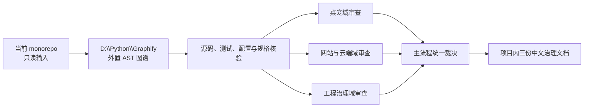

# Graphify 外置架构审查与项目治理设计

> 文档状态：用户已确认
> 基准日期：2026-08-13
> 目标分支：`main_Graphify_test`
> 审查基准提交：`4ddb14f04f12b3f9341de47a866854450afb24ee`

## 1. 背景与目标

当前项目是 pnpm 管理的 TypeScript monorepo，包含桌宠型 AI Agent、网站、CloudBase API、角色包扫描器、共享包、发布工具及跨应用测试。项目已经通过 SDD、TDD 和前置设计持续开发，但功能长期叠加后，出现模块膨胀、兼容路径扩散、修改成本升高和架构关系难以掌握的风险。

本轮工作暂停 Bug 修复和业务功能开发，先完成一次证据驱动的全项目架构审查。Graphify 用于发现代码关系候选，人工审查用于核验真实依赖、运行时语义和架构影响，最终形成可长期维护的中文架构治理文档与优化路线图。

本轮目标：

1. 在不污染当前项目的前提下，将 Graphify 配置为仓库外的旁路分析工具。
2. 生成全仓代码关系图，识别包、文件、类、函数和调用之间的关系。
3. 按全仓、桌宠、网站与云端、工程治理四个层次审查项目。
4. 找出并核验冗余、重复、浅模块、超大模块、跨域耦合、循环依赖、隐式协议、文档漂移和测试结构问题。
5. 给出包含目标结构、迁移顺序、前置条件、风险和验收标准的详细优化路线图。

## 2. 非目标

本轮不执行以下工作：

- 不修复现有 Bug。
- 不新增或替换业务功能。
- 不进行批量重构、移动或删除业务文件。
- 不把 Graphify 作为项目运行时、构建时或开发依赖。
- 不修改根 `package.json`、`pnpm-lock.yaml`、`pnpm-workspace.yaml` 或 `.gitignore`。
- 不安装 Graphify 项目级 Codex skill、Git hook、`AGENTS.md` 规则或 `.codex/hooks.json`。
- 不启用 Graphify 的文档、PDF、图片、音视频或 LLM 语义提取。
- 不使用 Docker、Neo4j、FalkorDB 或共享 MCP 服务。
- 不根据未经核验的图谱边直接提出删除或大范围重构结论。

## 3. 已确认决策

### 3.1 工具隔离

Graphify 完全位于当前仓库之外：

```text
D:\Python\Graphify\
├── tool\
│   └── .venv\                 # Graphify 0.9.41 独立 Python 环境
└── runs\
    └── myself-main_Graphify_test-2026-08-13\
        └── graphify-out\      # 原始图、报告、HTML、manifest 和缓存
```

安装版本固定为 `graphifyy==0.9.41`。升级 Graphify 必须单独评审版本变更和图谱准确性，不自动跟随最新版。

Graphify 只读取：

```text
C:\Users\Administrator\.codex\worktrees\38cc\myself
```

Graphify 的工具环境、缓存、中间文件、`graph.json`、`GRAPH_REPORT.md`、交互式 HTML 和其他原始导出全部写入 `D:\Python\Graphify`，不得进入当前项目。

### 3.2 最低侵入运行方式

采用 Graphify 官方纯代码 AST 路径：

```text
detect → extract --code-only → cluster-only --no-label → export html
```

代码分析不使用 API key，不调用 LLM，不上传仓库内容。首次安装 Graphify 依赖时允许联网；安装完成后的代码提取、聚类和 HTML 浏览均按本地流程执行。

### 3.3 项目内长期产物

当前项目最终只保留三份中文治理文档：

```text
docs/architecture/system-map.md
docs/architecture/audits/2026-08-13-full-audit.md
docs/architecture/audits/2026-08-13-optimization-roadmap.md
```

职责分别为：

- `system-map.md`：记录稳定的上下文、模块、接口、依赖方向和 Mermaid 关系图。
- `full-audit.md`：记录审查范围、方法、Graphify 可信度抽检及带源码证据的问题清单。
- `optimization-roadmap.md`：记录分阶段治理顺序、目标结构、依赖关系、迁移风险和验收标准。

不得复制原始 `graph.json`、Graphify HTML、缓存或批量生成页面到项目内。

## 4. 审查架构

### 4.1 总体数据流



### 4.2 审查顺序

审查按以下顺序执行：

1. **全仓基线**：建立 workspace、应用、共享包、构建工具和测试之间的总关系图，识别跨业务连接。
2. **桌宠域**：重点审查 Electron main/preload/renderer 的 seam、Agent Core、角色运行时、角色资源、文件工具、IPC、存储和兼容路径。
3. **网站与云端域**：重点审查 Next.js 网站、CloudBase API、角色包扫描器、共享契约、内容存储和发布下载链路。
4. **工程治理域**：重点审查测试分层、超大测试文件、构建脚本、发布工具、配置一致性、规格与实现漂移。
5. **跨域汇总**：统一识别共享类型是否过宽、跨域协议是否隐式、重复实现是否应下沉，以及未来开发应遵守的依赖方向。

### 4.3 模块设计审查词汇

审查统一使用以下术语：

- **模块**：具有 interface 与 implementation 的函数、类、包或跨层纵向切片。
- **interface**：调用者正确使用模块必须知道的全部事实，包括类型、约束、顺序、错误和性能特征。
- **seam**：可以替换行为而不修改调用位置的接口所在处。
- **adapter**：在 seam 处满足 interface 的具体实现。
- **深模块**：以较小 interface 隐藏较多行为，为调用方提供高 leverage，并把修改集中为高 locality。
- **浅模块**：interface 与 implementation 复杂度接近，或只做透传，增加理解成本但没有隐藏复杂度。

对每个重要模块至少回答：

1. 模块做什么？
2. 调用者如何使用？
3. 模块依赖什么？
4. interface 是否小于 implementation 所隐藏的复杂度？
5. 删除该模块后，复杂度会消失还是扩散到多个调用方？
6. 测试是否通过同一 seam 验证行为，还是必须穿透 implementation？

## 5. Graphify 证据规则

Graphify 输出是静态分析线索，不是编译器级完备事实。每条边按以下方式处理：

- `EXTRACTED`：源码明确表达的关系，优先核验，但不自动视为架构缺陷。
- `INFERRED`：Graphify 二次解析或消歧产生的关系，必须核验解析路径和实际调用上下文。
- `AMBIGUOUS`：无法唯一解析的关系，只能作为调查线索；未经源码证实不得进入最终结论。

每个最终问题至少包含：

1. 问题标题和严重度。
2. 受影响的业务上下文与模块。
3. 文件路径、行号或符号级源码证据。
4. Graphify 关系证据及其置信类型；如果问题不是由 Graphify 发现，则明确标注人工发现。
5. 当前行为及其维护、正确性、安全、性能或测试影响。
6. 推荐目标结构和 seam。
7. 最小迁移步骤、前置条件和回滚点。
8. 可验证的完成标准。

## 6. 问题严重度

问题统一分为四级：

- **S0 阻断**：可能导致安全边界失效、数据损坏、不可恢复行为，或与已确认产品架构根本冲突。
- **S1 高**：核心模块无法独立演进、跨域强耦合、关键依赖方向倒置，或高频修改会造成广泛回归。
- **S2 中**：明显增加修改成本的超大模块、重复逻辑、浅模块、隐式协议、测试穿透或局部结构混乱。
- **S3 低**：命名、目录布局、局部冗余、低风险文档漂移和可延后清理项。

严重度只描述影响，不代表本轮会直接修改代码。所有优化项都进入路线图，由后续独立规格和 TDD 计划实施。

## 7. 六阶段执行流程

### 阶段 0：预检与只读基线

记录并核验：

- 当前分支为 `main_Graphify_test`。
- 当前提交为本规格头部记录的基准提交，或明确记录之后的用户变更。
- 工作区是否干净；如果发现未说明修改，停止并询问用户。
- `D:\Python\Graphify` 的真实路径和现有内容。
- 当前 Python、uv 和 Graphify 是否已安装及其版本。
- 当前项目 `.gitignore` 已覆盖 `node_modules`、`dist`、`out`、`coverage`、`.next` 和 `.superpowers`。

### 阶段 1：外置工具环境

在 `D:\Python\Graphify\tool\.venv` 创建独立环境并固定安装 `graphifyy==0.9.41`。不克隆 Graphify 源码，不修改用户级 Codex skill，不修改当前项目依赖。

安装后验证：

- Graphify 命令可从该独立环境直接调用。
- 版本精确为 `0.9.41`。
- 当前项目 `git status --short` 与安装前一致。
- 当前项目内没有新增 `.graphify*` 或 `graphify-out`。

### 阶段 2：全仓建图

从 monorepo 根目录执行纯代码提取，输出到：

```text
D:\Python\Graphify\runs\myself-main_Graphify_test-2026-08-13
```

生成并保留：

- `graphify-out/graph.json`
- `graphify-out/.graphify_analysis.json`
- `graphify-out/manifest.json`
- `graphify-out/GRAPH_REPORT.md`
- `graphify-out/graph.html`
- Graphify 所需的本地缓存与状态文件

不生成文档语义图，不扫描 Git 忽略的依赖或构建产物，不导出 Neo4j、FalkorDB、Obsidian 或 Wiki 批量页面。

### 阶段 3：图谱可信度校验

在进入架构结论前，抽样检查以下关系：

- pnpm workspace 包到 `@myself/*` 包的真实依赖。
- `tsconfig` 路径解析和包 `exports` 解析。
- barrel export 到真实实现文件的关系。
- Electron main、preload、renderer 之间的 IPC 契约。
- Agent Core 与 character runtime、shared types 的包间关系。
- 网站与 CloudBase API 共享契约但不直接依赖桌宠实现的事实。
- 动态 import、依赖注入、事件回调或运行时注册造成的漏边和误边。

可信度门的通过条件：

1. 已知真实包依赖能够在图中找到。
2. 抽样关键源码关系没有被系统性错误解析。
3. 对动态关系的局限有明确记录。
4. Graphify 原始结果与项目工作区完全隔离。

如果可信度门不通过，则 Graphify 降级为目录与符号索引，不用其社区、中心性或意外连接结果作为架构判断依据；审查改用源码、TypeScript 配置和包依赖证据继续进行。

### 阶段 4：分域审查

采用 SDD 的只读并行审查方式：

- 桌宠域审查代理只读取桌宠应用、Agent Core、角色包和文件工具相关代码。
- 网站与云端域审查代理只读取网站、CloudBase API、扫描器和共享契约相关代码。
- 工程治理域审查代理只读取测试、构建、发布、配置与历史规格。
- 主流程读取 Graphify 总图，核验跨域关系，统一裁决重复或矛盾结论。

审查代理不得修改项目文件。各代理的中间报告写入本次 SDD 的忽略目录或 `D:\Python\Graphify\runs`，最终只由主流程写入三份长期中文文档。

### 阶段 5：汇总与交付

主流程完成：

1. 合并重复发现并统一严重度。
2. 对 S0、S1 和跨域问题逐条回到源码复核。
3. 区分“当前真实缺陷”“演进风险”“合理兼容成本”和“Graphify 误报”。
4. 生成系统关系总览、完整审查报告和优化路线图。
5. 验证项目最终差异只包含批准的中文规格与治理文档。

## 8. 重点审查维度

### 8.1 结构与依赖

- workspace 包依赖是否单向、无循环且职责清晰。
- 网站与桌宠是否只通过必要共享契约连接。
- 共享包是否成为混合业务语义的“万能包”。
- 应用层是否反向泄漏到通用包。
- barrel export 是否扩大了不必要的 interface。
- Electron main/preload/renderer seam 是否清晰且安全。

### 8.2 代码冗余与复杂度

- 重复 schema、类型、校验、转换和错误映射。
- 同一业务规则是否在调用方重复实现。
- 兼容 V1/V2 路径是否永久扩散到所有层。
- 超大文件是否混合存储、事务、迁移、校验和编排职责。
- pass-through adapter 和浅模块是否只增加跳转成本。
- 已替换旧功能是否仍保留无调用实现。

### 8.3 运行时关联

- Electron IPC、preload 暴露面和 renderer 调用是否一致。
- Agent 请求、授权、确认、执行、反馈和持久化链路是否闭合。
- 角色行为、动画播放和文件任务结果是否存在隐式共享状态。
- 网站、CloudBase 和扫描器之间的数据契约、鉴权和错误语义是否一致。
- 构建产物、发布 manifest 与网站下载入口是否一致。

### 8.4 测试与工程治理

- 单元、集成、安全和 E2E 测试是否各自验证正确 seam。
- 超大测试文件是否说明生产 interface 过宽或 fixture 复用不足。
- 测试是否大量复制生产数据结构和兼容分支。
- 构建、类型检查和验证脚本是否存在重复、遗漏或职责交叉。
- 历史规格、验收文档和当前实现是否相互矛盾。
- 已退役能力是否仍在计划、测试或实现中造成认知噪声。

### 8.5 可维护性与演进

- 高频修改是否集中在少数 God Nodes。
- 新功能是否必须同时修改多个不相关目录。
- 核心模块能否通过小 interface 独立测试和替换。
- 未来桌宠安装包、网站发布和云端部署是否可以独立演进。
- 优化是否能够按纵向切片逐步完成，而不是一次性重写。

## 9. 错误处理与停止条件

出现以下任一情况时立即停止当前阶段并报告，不猜测、不绕过：

1. Graphify 安装版本无法固定或依赖来源无法确认。
2. Graphify 在当前项目内意外创建文件或修改配置。
3. 图谱抽样表现出系统性漏边、误边或路径解析错误。
4. 工作区出现未说明的用户修改，影响审查基线。
5. 后续步骤需要删除大量文件或覆盖现有资料。
6. 某个结论必须依赖真实运行时行为，但无法通过安全的只读或测试方式验证。
7. 不同规格、代码和用户已确认决策之间出现根本矛盾。
8. 审查范围需要扩大到当前未授权的外部系统、生产环境或敏感数据。

Graphify 失败不会阻止整项审查：保留失败证据，改用包清单、TypeScript 配置、源码导入关系、测试和运行时契约继续人工审查。

## 10. 验证策略

### 10.1 隔离验证

- 安装前、建图后和最终交付前分别执行只读 `git status --short --branch`。
- 搜索当前项目内是否出现 `graphify-out`、`.graphify*` 或 Graphify 新依赖。
- 比较根依赖清单和锁文件是否保持不变。

### 10.2 图谱验证

- 使用项目已知包依赖建立正向样本。
- 使用不存在的跨业务依赖建立负向样本。
- 抽查直接 import、barrel export、workspace alias、方法调用、事件回调和动态注册。
- 对 Graphify 的中心节点、社区和意外连接逐项追溯到源码。

### 10.3 文档验证

- 三份长期文档全部使用中文。
- Mermaid 图能够解析，节点名称和依赖方向与正文一致。
- 每个 S0、S1、S2 问题都有可定位源码证据和可验证完成标准。
- 路线图中的每一阶段都有明确前置、产物、风险、回滚点和验收命令或验收行为。
- 不包含 `TODO`、`TBD`、占位符或“适当处理”等不可执行表述。

### 10.4 Git 约束验证

用户已于 2026-08-13 明确授权本任务执行 Git 写操作。本轮允许按 SDD 检查点执行本地 `git add` 和 `git commit`；仍不执行 `git push`、合并、rebase、reset、clean 或删除分支，除非用户另行明确授权。

## 11. 优化路线图的组织原则

最终路线图不直接把所有发现变成重构任务，而按以下顺序组织：

1. **止血规则**：冻结新的跨域依赖，建立文件大小、依赖方向和 interface 变更守则。
2. **建立 seam**：优先处理最频繁修改、最难测试且影响多个调用方的核心路径。
3. **替换而非叠层**：新 module 验证通过后删除旧 implementation，避免新旧路径长期共存。
4. **纵向迁移**：每次只迁移一条完整业务流，并通过原 interface 或兼容 adapter 保持行为。
5. **测试跟随 interface**：测试通过稳定 seam 验证行为，减少穿透 implementation 的脆弱测试。
6. **清理兼容债务**：在数据迁移、版本支持和用户影响明确后，按独立规格删除过期兼容路径。
7. **恢复功能开发**：只有高优先级结构阻塞得到处理、架构守则生效后，才恢复大规模功能扩展。

每个后续优化阶段都必须单独进行 brainstorming、规格确认、TDD 计划、SDD 实施和审查，不在本轮审查中顺手改代码。

## 12. 完成标准

当且仅当满足以下条件，本轮架构审查才算完成：

1. Graphify 0.9.41 在 `D:\Python\Graphify\tool\.venv` 中可复现运行。
2. 原始图谱和全部 Graphify 状态只存在于 `D:\Python\Graphify`。
3. 全仓图已生成并完成已知依赖的正向、负向和动态关系抽检。
4. 桌宠域、网站与云端域、工程治理域均完成独立审查。
5. 跨域关系由主流程完成复核和统一裁决。
6. 项目内三份中文长期文档完整、相互一致且没有占位符。
7. 所有重要结论均能追溯到源码、测试、配置或已确认规格。
8. 优化路线图足以拆分成后续独立 SDD/TDD 规格，不依赖“一次性重写”。
9. 当前项目除批准的中文规格和治理文档外没有其他新增或修改。
10. Git 写操作严格限制在用户已授权的本地暂存与提交范围内。

## 13. 官方参考

- [Graphify 官方仓库](https://github.com/Graphify-Labs/graphify)
- [Graphify README](https://github.com/Graphify-Labs/graphify/blob/v8/README.md)
- [Graphify 架构文档](https://github.com/Graphify-Labs/graphify/blob/v8/ARCHITECTURE.md)
- [Graphify v0.9.41 Release](https://github.com/Graphify-Labs/graphify/releases/tag/v0.9.41)
- [Graphify CLI 源码](https://github.com/Graphify-Labs/graphify/blob/v8/graphify/cli.py)
