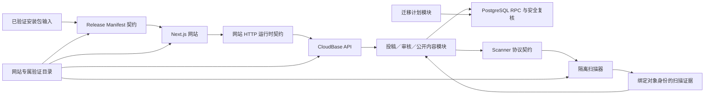
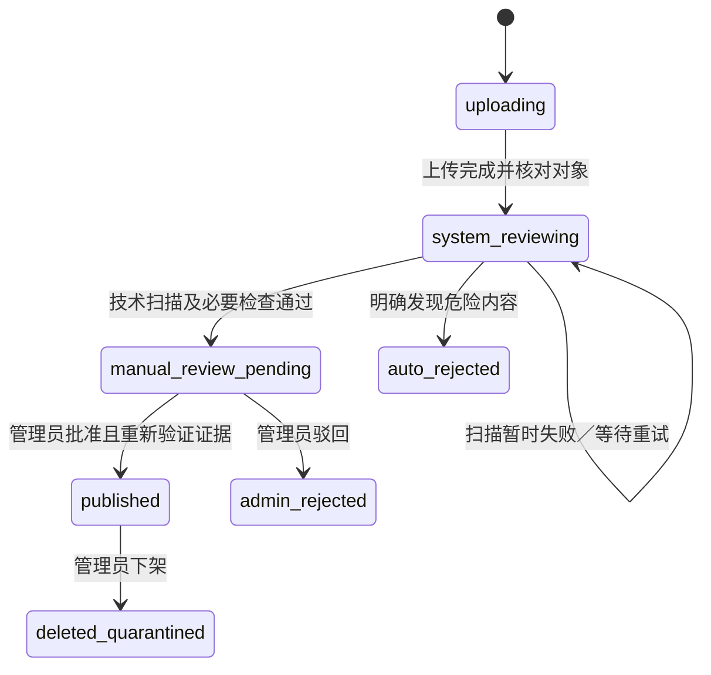

# 网站架构优化与正式上线重构设计

> 文档状态：用户已于 2026-08-15 书面批准  
> 日期：2026-08-15  
> 目标分支：`WebsiteExtension`  
> 适用业务：网站、CloudBase API、隔离扫描器、网站发布与正式上线链路  
> 实施方式：规格驱动开发、测试驱动开发、子智能体驱动开发

## 1. 文档目的

本规格用于在恢复普通网站功能开发前，先关闭网站链路中已经确认的安全、迁移、跨端契约和验证门缺口，并为后续中低优先级架构治理及 CloudBase 正式生产上线建立可执行边界。

本规格不授权立即实施代码重构、数据库迁移、部署、发布、远端数据修改或批量删除。每个实施阶段仍须生成独立实施计划；真实 CloudBase 或生产环境操作必须在执行前另行取得授权。

## 2. 输入证据与当前基线

### 2.1 审查输入

本规格综合以下两套外置审查结果：

- `D:\Python\Project Optimization\1`：dependency-cruiser 静态依赖审查、网站与 CloudBase 专项报告、横切报告、指标、原始 JSON、依赖图和渐进式优化方案。
- `D:\Python\Project Optimization\2`：Graphify 辅助的全仓架构审查、优化路线图和系统地图。

两套审查共同确认：当前包级依赖方向总体健康，主要问题不是应用之间已经互相穿透，而是同一业务契约由多处平行维护、测试替身与生产状态漂移、旧路径未退役，以及迁移、扫描和发布验证没有形成闭环。

审查材料属于 2026-08-13 的历史快照。当前 `WebsiteExtension` 的业务代码相对审查业务基准没有变化，但当前分支没有审查分支中的 `.dependency-cruiser.mjs`、`dependency-cruiser` 依赖和 `deps:audit` 脚本。因此审查中的 65 条 warning 只能作为历史证据；实施前必须恢复可复现工具并重新生成当前结果。

### 2.2 2026-08-15 自动化基线

本轮只读调查实际执行并观察到：

- website：41 个测试文件、319 个测试通过。
- cloudbase-api：19 个测试文件、195 个测试通过。
- package-scanner：5 个测试文件、64 个测试通过。
- release-tools：1 个测试文件、4 个测试通过。
- website、cloudbase-api、package-scanner、release-tools 的 TypeScript typecheck 均通过。

这些结果只证明当前实现与当前测试一致，不证明架构问题已经关闭。当前测试和 E2E 替身仍包含已确认的旧状态、重复协议和测试专用实现。

### 2.3 审查问题覆盖索引

| 主题 | 方法 1 编号 | 方法 2 编号 | 本规格处置 |
| --- | --- | --- | --- |
| 迁移执行器不闭合 | RC-01 | G-S1-1 | 阶段 1 冻结旧入口；阶段 2 建立事务型执行器 |
| 投稿状态与扫描安全漂移 | RC-02 | W-S0-1、W-S2-1、G-S2-1 | 阶段 1 止血；阶段 2 恢复扫描；阶段 3 统一跨端契约 |
| 网站链验证归属不闭合 | RC-03B、RC-03D | G-S1-2、G-S2-2、G-S3-1 | 阶段 0 建立网站专属门；阶段 2 补 Scanner 候选；阶段 5 收敛构建 |
| HTTP DTO 缺运行时契约 | RC-04 | W-S2-1 | 阶段 3 逐 endpoint 迁移 |
| 跨章节事件接缝错位 | RC-07 | — | 阶段 4 上移稳定交互契约 |
| Release Manifest 与发布身份多源 | RC-08 | W-S2-5 | 阶段 4 统一契约；阶段 5 候选与正式上线 |
| 旧网站实现未退役 | RC-13 | W-S2-2、W-S3-1 | 阶段 5 按簇删除并设置二次批准门 |
| 生产路由双权威 | RC-14 | — | 阶段 4 等待真实网关证据后独立裁决 |
| CloudBase 能力端口过宽 | RC-15 | — | 阶段 4 按真实能力收窄 |
| i18n type-only 循环 | RC-16 | — | 阶段 4 建立单向消息键权威 |
| 当前文档事实冲突 | RC-17 | G-S2-3 | 阶段 5 修复当前入口并保留历史记录 |
| 三函数配置耦合 | — | W-S1-1 | 阶段 2 按函数收窄配置 |
| Scanner 协议双 owner | — | W-S1-2 | 阶段 2 建立共享 wire contract 和真实 HTTP 契约测试 |
| offset 冒充 cursor | — | W-S2-3 | 阶段 4 按列表迁移 keyset cursor |
| 互动和下载不可安全重放 | — | W-S2-4 | 阶段 4 建立 desired-state、operationId 和一致计数语义 |
| 坏公开记录拖垮整页 | — | W-S2-6 | 阶段 4 建立发布不变量与逐项隔离 |
| RPC 无 deadline 和响应上限 | — | W-S2-7 | 阶段 4 建立有界远程调用 |
| 网站测试穿透桌面资源 owner | — | W-S2-8 | 只登记；另行批准扩围后处理 |

## 3. 已确认的产品与架构决策

### 3.1 共享角色包发布安全门

共享角色包只有在存在与当前上传对象身份绑定的有效技术扫描通过证据时，才允许进入管理员可批准状态并公开。

扫描器不可用、超时、响应畸形、证据缺失或证据过期时：

- 关闭新的共享包投稿或保持投稿隐藏；
- 禁止管理员批准；
- 公开内容只读、普通反馈和管理员查看继续可用；
- 不得降级为纯人工批准。

本决策取代 `docs/superpowers/specs/2026-08-08-direct-manual-review-design.md` 中“新共享包无需系统扫描即可批准”的部分。该历史规格的其他有效内容不因本规格自动失效。

### 3.2 CloudBase SDK

后端按 CloudBase 官方 V3 Node.js 接入方式统一使用 `@cloudbase/js-sdk`。三个云函数完成兼容迁移和验证后删除 `@cloudbase/node-sdk`，不保留长期双 SDK。

本决策恢复并继续执行 `docs/superpowers/specs/2026-08-01-cloudbase-js-sdk-v3-pg-compatibility-design.md` 的有效方向。当前源码和测试中固定旧 Node SDK 的事实不是新的产品决策，实施时必须通过 RED/GREEN 迁移并删除旧依赖。

### 3.3 正式部署平台

正式网站采用 CloudBase 单平台生产方案：

- 独立 CloudBase 生产环境；
- CloudBase PostgreSQL；
- 私有对象存储；
- `api`、`moderation-worker`、`cleanup` 三个云函数；
- CloudBase Run 隔离扫描器；
- CloudBase Hosting 承载 Next.js 静态导出；
- 绑定正式备案域名并强制 HTTPS。

测试环境与生产环境的数据库、Bucket、密钥、管理员账号、域名、告警和备份必须完全隔离。Vercel、Cloudflare 和其他托管平台不进入本轮正式生产链路。

### 3.4 恢复普通功能开发的门

普通网站功能开发先冻结。只有以下条件全部满足后才恢复：

- 网站 S0 安全问题关闭；
- 网站 S1 基础设施问题关闭；
- 固定单 SQL 的旧迁移入口已退役，新入口可审计、可续跑；
- Scanner 协议、构建和失败关闭通过；
- CloudBase 后端只使用 JS SDK V3；
- 关键 HTTP 远程响应经过运行时 Schema；
- 网站完整验证门可重复执行并说明外部未验证项。

其余 S2/S3 债务继续分阶段治理，但只阻塞与其直接相关的后续功能。

## 4. 范围边界

### 4.1 允许修改

- `apps/website/**`
- `apps/cloudbase-api/**`
- `apps/package-scanner/**` 中的远程协议、适配器、构建、部署和验证；不得改变角色包业务语义
- `packages/shared-types/**` 中必要的审核、HTTP、Scanner 和发布运行时契约
- `cloudbase/migrations/**` 中新增的前向迁移及迁移契约测试
- `tools/apply-cloudbase-migrations*`
- `tools/build-cloudbase-functions*`
- `tools/release/**`
- 网站 E2E、内存 HTTP 适配器和网站发布验证脚本
- 根验证脚本、必要的根依赖配置和锁文件
- 网站、CloudBase、扫描器、迁移、发布和正式上线相关文档

### 4.2 严禁修改

- `apps/desktop/**`
- `packages/agent-core/**`
- `packages/file-tools/**`
- `packages/character-runtime/**`
- `packages/character-assets/**`
- 其他桌宠或角色业务实现
- 桌宠 E2E、安全测试、集成测试和桌面发布配置

网站默认角色发布投影测试当前直接读取桌面资源目录。本轮只登记该跨应用关系，不修改桌面资源 owner、资源字节、角色 Schema 或桌面测试。

### 4.3 外部副作用限制

以下操作不由本规格自动授权：

- 执行真实数据库迁移；
- 创建、修改或删除 CloudBase 资源；
- 部署云函数、Scanner 镜像或静态网站；
- 修改生产域名、CORS、CSP、OTP、密钥、告警或备份；
- 上传安装包或修改远端 Release Manifest；
- 删除远端投稿、对象或生产数据；
- Git 暂存、提交、推送、建分支、合并或创建 PR。

## 5. 目标架构

### 5.1 总体结构



### 5.2 共享运行时契约

`packages/shared-types` 保留现有根入口兼容，并为新的跨应用 wire contract 提供明确子路径。共享包只保存真实跨进程、跨应用或生产者/消费者共同依赖的 Zod Schema 与类型：

- 投稿回执和审核状态；
- 网站 HTTP 请求、响应和错误信封；
- Scanner 协议版本、请求、响应、错误和规范签名输入；
- Release Manifest 的 published/unpublished 联合契约。

业务服务、数据库端口、UI Model、存储 Adapter 和页面状态不得进入共享包。不得把新契约继续全部堆入根 barrel。

### 5.3 发布安全复核

服务层和 PostgreSQL RPC 都保留发布前复核。这里的双层校验是有意安全防线，不属于待删除重复实现。

两层使用同一组行为案例验证以下语义一致：

- 共享包必须有当前有效扫描证据；
- 对象身份或状态版本变化使旧证据失效；
- 管理员身份、动作、理由、幂等键和预期版本合法；
- 未批准内容不能进入 `published`。

不得建立第三个只做转发的 `SharedPackagePublicationGate` 作为新的规则 owner。

### 5.4 CloudBase 函数配置

三个函数拥有各自最小配置加载器：

- API：公开与管理员 HTTP、数据库、存储、管理员认证和滥用控制；
- moderation-worker：审核、存储、Scanner 和内容安全；
- cleanup：数据库、存储和清理配置。

共享读取器只处理真正共同字段。cleanup 不得因 Scanner 配置缺失失败，公开 API 不得因审核 Worker 的无关配置缺失而无法提供只读内容。

### 5.5 CloudBase V3 运行时

`CloudBaseServerRuntime` 隐藏 `@cloudbase/js-sdk` V3 初始化，并向函数组合根提供最小 `rdb`、storage 和 auth 能力。PostgreSQL RPC 的服务端 API Key 继续由独立服务端 Adapter 使用，不传入浏览器或普通运行时日志。

三个函数迁移后删除旧 `@cloudbase/node-sdk`、模块补充声明、旧初始化路径和只锁定旧实现的源码字符串测试。

### 5.6 Scanner 远程接缝

`ScannerProtocol` 是真实远程接缝，由以下 Adapter 共用：

- CloudBase HTTP Client；
- Scanner HTTP Server；
- 测试内存或临时 HTTP Server Adapter。

契约拥有协议版本、请求/响应 Schema、错误分类、请求时限、响应大小上限和规范 HMAC 签名输入。扫描器内部继续复用现有角色包公开 Schema，不修改角色包实现。

### 5.7 数据库迁移模块

`CloudBaseMigrationPlan` 隐藏迁移发现、排序、校验和、不可变账本、专用数据库会话、整轮 advisory lock、逐份事务和失败续跑。

旧的固定单 SQL 入口只在新接口、故障注入和非生产环境冒烟通过后删除。历史迁移永不改写；已提交数据库变更只允许使用新的前向迁移修复。

### 5.8 网站交互与 Repository

- 网站组件只依赖 Repository 和稳定交互契约。
- `LiquidGlassHome` 恢复为渲染模块，不再拥有六个章节需要学习的全局事件名称和载荷类型。
- 生产只保留 Cloud Repository；测试使用实现同一 Interface 的内存 Adapter。
- IndexedDB/LocalStorage 历史 Repository 在页面行为迁移和删除批准后退役，不保留兼容 Wrapper。
- 大文件只按职责和变化原因拆分，不按行数机械拆分。

## 6. 共享角色包状态流



### 6.1 投稿开关

共享包投稿使用服务端配置开关。生产环境初始关闭；只有 Scanner 候选、协议契约和真实开发环境冒烟均通过后才允许开启。

浏览器可以展示关闭说明，但安全事实由服务端决定。关闭共享包投稿不得影响公开内容读取、普通反馈、管理员登录或管理员查看已有记录。

### 6.2 扫描证据身份

扫描证据至少绑定：

- `submissionId`；
- 不可变 `objectKey`；
- 实际 ZIP 大小；
- Scanner 对完整 ZIP 计算的 SHA-256；
- Scanner 协议版本和规则版本；
- 扫描结果码与完成时间；
- 投稿 `statusVersion`。

如果 CloudBase 对象存储能够提供经过真实验证的稳定对象版本或 ETag，则一并保存。若平台不能可靠提供，则使用不可覆盖对象键、实际大小和完整 ZIP SHA-256 建立身份。

管理员批准时，服务层和 PostgreSQL RPC 都重新验证当前对象与证据。对象替换、大小或哈希变化、状态版本变化、证据过期或协议版本不接受时，批准失败。

### 6.3 普通反馈

普通反馈和建议继续使用：

```text
匿名提交 → manual_review_pending → 管理员批准或驳回
```

反馈不依赖角色包 Scanner，但继续保留限流、字段校验、管理员身份复核和数据库公开状态检查。

## 7. 实施阶段与进入条件

### 7.1 阶段 0：可信基线

- 移植已审查的 dependency-cruiser 18.2.0 配置。
- 新增网站链专属依赖审查入口，不把桌宠告警转化为本分支任务。
- 建立 `verify:web-chain`，覆盖 shared-types、website、cloudbase-api、package-scanner、release-tools、根级 CloudBase 工具、网站 E2E 和网站依赖审查。
- 建立修改范围检查；桌宠黑名单路径出现在分支差异中时失败。
- 区分快速包级门和完整网站链门。

退出条件：当前测试、typecheck、构建归属和外部门目录可机器读取；审查工具能在当前分支重现网站链结果。

### 7.2 阶段 1：立即止血

独立子项目一：共享包无扫描批准止血。

- 服务层与 SQL 同时拒绝无有效证据的批准；
- 共享包投稿开关默认关闭；
- 管理员 UI 显示稳定阻塞原因；
- 不在该切片恢复 Scanner，不修改反馈流。

独立子项目二：迁移入口冻结。

- 旧固定 SQL 写入入口禁止用于任何环境；
- 建立 inventory、顺序、校验和与 dry-run；
- 运维文档移除旧入口的有效执行指引。

退出条件：S0 路径已失败关闭；普通功能开发仍冻结。

### 7.3 阶段 2：关闭网站 S1

以下项目分别建立规格和计划：

1. CloudBase JS SDK V3 迁移并删除旧 Node SDK。
2. cleanup、API、moderation 配置加载器逐项收窄。
3. Scanner Client/Server 共享协议及真实契约测试。
4. Scanner build、bundle、Docker、非 root、health、EICAR、超时和镜像身份门。
5. 事务型迁移执行器、故障注入和开发环境 PostgreSQL 冒烟。
6. 恢复共享包 `system_reviewing` 扫描链和完整 ZIP 身份证据。
7. 开发环境扫描链通过后开启共享包投稿。

退出条件：所有网站 S1 有稳定 Interface、生产与测试 Adapter、失败门和删除条件；未完成真实 Scanner 验收时投稿继续关闭。

### 7.4 阶段 3：关闭跨端契约缺口

- 投稿回执使用真实状态，不再由泛型固定旧值。
- HTTP endpoint 逐条迁移到共享运行时 Schema，每次只处理一个 endpoint 并删除本地重复 DTO。
- 网站 E2E 内存后端与生产 `createApi` 共用行为案例，不共用数据库实现。
- 管理员认证头、401/403、状态版本和幂等错误使用真实生产 Interface。
- `verify:web-chain` 覆盖全部网站发布目标。
- 对应依赖告警清零后逐条由 warn 升为 error。

退出条件：满足第 3.4 节恢复普通功能开发的全部门。

### 7.5 阶段 4：持续治理 S2

以下项目不整体阻塞无关功能，但修改对应模块前必须优先完成：

- keyset cursor：公开社区、反馈、管理员队列逐条迁移；
- 点赞 desired-state 与 operationId；
- 下载签名成功和幂等计数的一致语义；
- 公开内容写入不变量和坏记录逐项隔离；
- CloudBase RPC deadline 与响应大小上限；
- Release Manifest 单一运行时契约；
- `LiquidGlassHome` 交互契约上移；
- CloudBase 能力端口收窄；
- i18n 消息键单向权威并消除 type-only 循环；
- 生产路由单一权威。

生产 Router 的保留或删除必须等待真实 CloudBase 网关 `/api` 前缀行为证据，不在本规格中预判。

### 7.6 阶段 5：退役、收尾和正式上线

- 审计当前入口、动态引用、CSS 和资产。
- 按簇删除旧首页、历史本地 Repository 和只维护旧实现的测试。
- 每个删除簇执行前再次取得用户批准；不得一次性大量删除。
- 消除重复网站构建和互斥文档状态。
- 生成正式发布候选并进入第 9 节生产上线流程。

## 8. 失败处理与安全不变量

### 8.1 失败处理

- Scanner 投稿前不可用：共享包 prepare 返回稳定暂停错误。
- Scanner 上传后失败：投稿保持隐藏并等待受控重试，不进入批准队列。
- Scanner 响应畸形、超大、过期或签名失败：统一失败关闭，不暴露第三方原始响应。
- 管理员批准缺证据：服务层与数据库均拒绝。
- 函数配置缺失：只阻断需要该配置的函数。
- HTTP 响应不满足 Schema：浏览器 Adapter 返回 `INVALID_RESPONSE`。
- 迁移顺序、校验和、账本或锁异常：在 SQL 写入前停止。
- 迁移已提交后的错误：新增前向修复迁移。
- 生产异常：关闭写入口并回切上一网站或函数候选，公开只读继续服务。

### 8.2 安全与隐私

- API Key、Secret、Bearer、OTP、状态令牌、签名 URL、私有对象键和管理员邮箱不得进入普通日志或浏览器非必要状态。
- 管理员邮箱 OTP、网关认证、应用层会话、邮箱白名单和角色复核同时保留。
- 私有投稿对象不得公开读取；下载只签发短期地址。
- 扫描证据只保存最小技术摘要，不长期保存完整 ZIP 内容、OCR 全文或第三方原始响应。
- 正式安装包与匿名投稿隔离区保持独立。
- 所有远程调用必须有 deadline、响应大小上限和稳定错误分类。
- 测试与生产环境不得共享数据库、Bucket、密钥、管理员账号或域名配置。

## 9. CloudBase 正式上线流程

当前线上内容只视为测试版。优化完成不等于正式上线完成。

### 9.1 仓库门

以下项目必须自动化通过：

- shared-types、website、cloudbase-api、package-scanner、release-tools 的测试与 typecheck；
- 网站、CloudBase 函数和 Scanner 构建；
- 网站 E2E、HTTP 契约、Scanner 契约、迁移故障注入和 Release Manifest 产消契约；
- 网站链依赖审查、范围检查和 `git diff --check`。

### 9.2 发布候选门

候选包含：

- Next.js 静态导出；
- 三个云函数 bundle；
- Scanner 镜像 digest、Node/ClamAV/病毒库版本和 smoke 结果；
- published/unpublished Release Manifest；
- 外部分支交付的已验证桌宠安装包身份、大小和 SHA-256。

本分支只消费安装包身份，不修改桌宠安装包、builder 或桌面版本。

### 9.3 开发环境门

在现有 CloudBase 测试环境验证：

- 迁移 inventory、dry-run、账本和续跑；
- 三个函数入口；
- Scanner HMAC、干净包、EICAR、结构边界、超时和失败关闭；
- 邮箱 OTP、管理员 401/403；
- 私有 Bucket 与短期 URL；
- 反馈和共享包完整投稿、审核、发布、删除和恢复；
- Release Manifest 与下载候选一致。

### 9.4 生产准备

- 创建独立生产环境；
- 建立数据库备份和恢复演练记录；
- 配置生产 Bucket、密钥、唯一管理员、告警和日志期限；
- 配置正式备案域名、HTTPS、CORS、CSP 和安全域名；
- 记录上一静态站、函数和 Scanner 候选身份；
- 保持共享包投稿关闭。

### 9.5 受控部署和切换

1. 执行生产迁移计划并核对账本。
2. 部署 Scanner 镜像并验证 health 和失败关闭。
3. 部署三个云函数。
4. 部署静态网站，但保持共享包投稿关闭。
5. 验证公开只读、反馈、管理员 401/403、私有对象、干净包、危险包拒绝和下载。
6. 绑定正式域名并强制 HTTPS。
7. 确认监控和告警后开启共享包投稿。
8. 记录生产环境、命令、候选身份、时间和实际观察结果。

### 9.6 回滚

- 静态网站和云函数可以回切上一候选。
- Scanner 可以回切上一已验证镜像。
- 数据库不得回滚历史迁移，只能新增前向修复迁移。
- 严重故障立即关闭写入口，公开只读继续服务。
- 回滚后重新验证管理员权限、私有存储、下载和失败关闭。

正式域名、生产环境 ID、密钥、安装包 URL 和真实数据不得写入普通规格或日志。没有生产证据时只能标记“待正式上线”。

## 10. TDD、子智能体与验证治理

### 10.1 单个子项目流程

1. 先写一个稳定证明当前缺陷的最小失败测试。
2. 运行并确认失败原因正确。
3. 编写使该测试通过的最小实现。
4. 通过同一 Interface 运行生产与测试 Adapter 契约。
5. 重构内部实现，保持测试为绿。
6. 删除被替代的旧入口、复制契约和只维护旧实现的测试。
7. 运行包级测试、typecheck、相关 build 和 `verify:web-chain`。
8. 运行范围检查与 `git diff --check`。

### 10.2 禁止的实施方式

- 先写完整实现再补形式化测试；
- 用源码字符串断言代替可执行行为；
- 永久保留新旧双轨或兼容 Wrapper；
- 只按文件行数拆模块；
- 用静态依赖图证明 SQL、HTTP、容器或部署正确；
- 把本地通过写成生产上线成功；
- 在共享契约、迁移或同一状态机上并行运行多个实现子智能体。

### 10.3 子智能体执行方式

- 每个纵向任务由新的实现子智能体执行；
- 每个任务完成后进行规格符合性和代码质量双重审查；
- 主智能体负责范围、接口一致性、跨任务整合和最终验证；
- 独立只读调查和测试分析可以并行；
- 任务未通过审查前，不进入依赖它的下一任务。

## 11. 删除与替换纪律

新 Interface 和生产路径通过定向测试、失败路径、相关 build 及必要环境验收后，必须删除：

- 被替代的旧实现；
- 旧入口和旧别名；
- 复制的 DTO、Schema、协议常量和状态值；
- 只维护旧实现内部细节的测试；
- 无退出条件的兼容 Adapter。

大量网站文件删除必须先给出精确目标、引用、CSS、资产、恢复方式和验证结果，再取得用户二次批准。数据库历史迁移和生产数据不属于可删除清理项。

## 12. 验收状态与完成定义

所有验收只使用以下状态：

- 自动化通过；
- CloudBase 开发环境通过；
- CloudBase 生产环境通过；
- 待用户人工确认；
- 失败；
- 不在本次范围。

真实域名、CORS/CSP、OTP、数据库事务、Bucket、Scanner 镜像、ClamAV 数据库、告警、备份和正式下载字节必须有外部环境证据。没有证据时不得写为通过。

本大型优化完成的定义是：

- 阶段 0—3 的退出条件全部满足，普通网站功能开发门恢复；
- 阶段 4 的每项债务具有 owner、进入条件和独立规格，不再作为无边界待办；
- 阶段 5 的获批退役项完成，旧路径没有永久双轨；
- 正式 CloudBase 生产上线完成并留下日期化验收记录，或明确保持“待正式上线”；
- 分支差异没有触碰桌宠黑名单；
- 文档、代码、测试和实际部署状态不存在互相冲突的当前事实。

## 13. 非目标

- 不重构、修复或测试桌宠业务。
- 不修改角色包 Schema、角色扫描业务语义或桌面默认资源 owner。
- 不引入第二套网站框架、数据库框架或 Agent 框架。
- 不迁移到 Vercel、Cloudflare、Supabase 或其他生产平台。
- 不建设账号系统、普通用户登录、订阅、支付或长期用户画像。
- 不让浏览器直接访问 PostgreSQL 或持有私有 Bucket 长期权限。
- 不以代码行数下降、文件数量变化或静态 warning 数量作为唯一成功指标。

## 14. 待后续独立规格裁决的事项

- 生产 `createRouter` 是深化并接管 dispatch，还是在生产行为测试完整后删除；进入条件是真实 CloudBase 网关前缀证据。
- 网站默认角色发布投影如何脱离桌面内部路径；该事项涉及桌面资源 owner，必须另行批准扩围。
- `.glb` 大型发布资产是否继续直接进入静态站、是否使用 CDN、压缩或懒加载；需先取得真实托管限制和性能数据。
- CloudBase Run 多实例下 Scanner 重放守卫是否需要共享存储；需结合真实扩缩容配置和威胁模型单独设计。

## 15. 规格确认后的下一步

用户复核本规格后，为阶段 0—3 分别建立可执行计划。计划必须包含精确文件、Interface、依赖、RED/GREEN 步骤、删除条件、验证命令和人工/外部验收门。阶段 4—5 只建立索引和进入条件，不提前为尚未稳定的后续接口编写失真的代码级计划。
